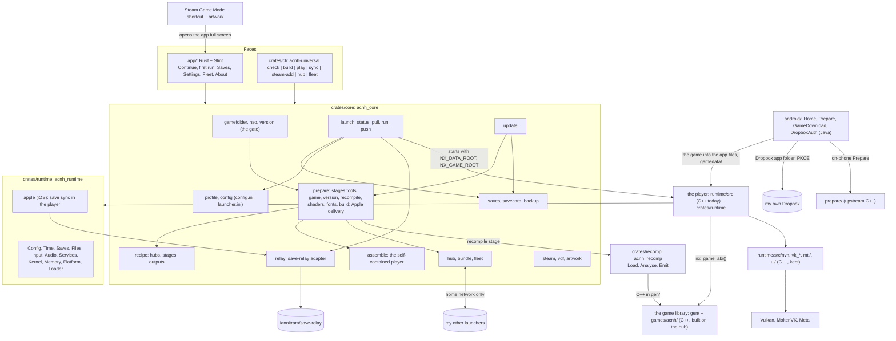

# Code map: ACNH Universal

The intended shape of the repo for 1.0 (`SPEC.md`, approved 2026-11-02; M5 widened and approved again 2026-11-17; M4 and the Dropbox exception changed and approved again 2026-11-18; M18, M4 and the Dropbox exception changed so Android and iPhone/iPad may download the game at first start from my own Dropbox, and approved again 2026-11-23, #232): **one Rust engine, two faces, one recompiler, one runtime, three hubs, five platforms**. The engine (`crates/core`, library `acnh_core`) checks my game folder and its version, prepares a build for each device family on a hub, serves it to my other devices over the home network, writes the Steam shortcut with artwork, and wraps every start in a save-relay pull and push. The recompiler (`crates/recomp`, `acnh_recomp`) turns `exefs/main` into the C++ the game library is built from, replacing upstream's `recomp/` (Python). The runtime (`crates/runtime`, `acnh_runtime`) is the host side, replacing `runtime/src` outside the renderer one group of files at a time (ADR 0002), behind the C ABI the game library already uses (`runtime/include/nx/game.h`, `nx_game_abi()`); on iOS it also carries the player's save sync. The NVN renderer, `games/acnh/` and the in-game overlay stay C++ (ADR 0001). The faces are the Slint launcher (`app/`, ADR 0003) and the `acnh-universal` command line (`crates/cli`). Android keeps upstream's route (ADR 0005); Mac, iPhone and iPad build the same recompiled code (ADR 0006).

Status per module: **present** (built), **partial** (some paths are wired), **stub** (the final types and signatures exist; constants and trivial pure helpers may be built, and any other function returns `Err(Error::NotBuilt(..))` or panics with "not built yet: <what>" when it cannot fail), **planned** (not in the tree), **legacy** (upstream's C++ or Python that we replace, removed when its Rust replacement is present and the game builds and boots). "Musts" columns cite `SPEC.md` (M1–M18); every module that replaces C++ or Python also serves M13. An issue that builds a module moves its status in the same PR. Integration branch: `main`. This map is checked against `main` as of 2026-11-24, after the upstream sync of 140 commits (#246), the Android, Fold, controller, movie and audio work (#248–#256), Android save-relay and Dropbox sign-in fixes (#259, #261–#263, #266), and Shadow Quality (#267); no module in `crates/` or `app/` returns `NotBuilt` any more, and the only stubs left are the runtime groups.

## Platforms (R04)

| Device family | 1.0 device | Game code | Renderer | Built on (hub) | Launcher | Save sync in | CI |
|---|---|---|---|---|---|---|---|
| Linux / SteamOS | the AMD handheld, the Strix Halo tablet | recompiled, x86-64 | NVN on Vulkan (RADV) | the Strix Halo tablet; the AMD handheld pulls | Slint launcher. The release supplies an AppImage and #191 covers the locally contained game folder | the launcher | GitHub-hosted Linux (ubuntu-24.04): workspace and the save-relay link check, game-data check, the Android cross-build, the C++ unit tests (every `*_test` target, ours and upstream's) and the game-root check, fake-game boot, emitter parity |
| Windows | the RTX 3090 Ti desktop | recompiled, x86-64 | NVN on Vulkan | the desktop | Slint app. The release supplies a zip and #190 covers the locally contained game folder | the launcher | GitHub-hosted Windows (windows-2025): workspace; the C++ build is 7.01 (#70) |
| macOS | a Mac with Apple silicon + controller | recompiled, ARM64 | MoltenVK, then upstream's Metal | the Mac | Slint launcher. On the Mac hub, Prepare makes both Apple deliverables into Dropbox: the contained Mac app (#171) and the iPhone and iPad `.ipa` (#170) | the launcher | GitHub-hosted macOS (macos-15): workspace with all features, the Homebrew MoltenVK assemble test, the save-relay link check, the Mac package test (`tests/package_mac_test.sh`); the Apple device builds are in the iOS row |
| iOS / iPadOS | iPhone or iPad + controller | recompiled, ARM64 (no JIT) | Metal (or MoltenVK). The Simulator reaches frames, then stops at a Metal limit only the Simulator has; the real `.ipa` is untested on a device | the Mac, by Prepare's `ios` target, as an unsigned `ACNH-Universal-<version>.ipa` with the game inside, in Dropbox, installed with SideStore (#74); the big `.ipa` stays, and `tools/package_ios.sh --small` makes a small one with no game inside plus the game's files and `manifest.json` in `acnh-universal-game/ios/` for Dropbox (`Apps/save-relay/`); the player downloads them at first start (#231) | game app | in the player through save-relay's Rust API (`acnh_core::relay`, via `crates/runtime` `apple`): pull before the game, push on quit and background; the Nextcloud setup is the first start's alert (server, user, app password in the Keychain; Not now is `relay.ask = 0` in `config.ini`) and comes back when the sign-in is refused; save-relay's own config is under `Library/`, not Documents | on macos-15: Rust target check, the runtime static library for the device, C++ compile for both SDKs, device and Simulator stub bundles and their bundle checks, Prepare's `ios_real` test (stages faked, scripts real, stub gen), the stub IPA and `tests/package_ios_test.sh` |
| Android | Adreno device + controller; my Pixel Fold (Tensor G2, Mali-G710) | recompiled, ARM64 | NVN on Vulkan: on Adreno the bundled Turnip (the system driver on Adreno 8xx); on any other GPU (Mali, PowerVR, Xclipse) the device's own driver. The Pixel Fold runs the game on its system driver (first save made); a GPU whose driver cannot run it gets a plain message before the game starts (#235) | the Strix Halo tablet (ADR 0004), staged into my Dropbox for the in-app download (`tools/stage_dropbox_game.sh`); upstream's on-phone Prepare also builds it on the phone itself; `tools/build_android.sh` also runs on a Mac with the Android SDK and JDK 17+ | Slint app, same APK as the player (9.01, #79); today the APK's shell (`Home.java`) asks for the game folder, prepares one on the phone, or downloads the game from my Dropbox | in the Android app (9.03, #81 / PR #259: save-relay C interface + JNI + Java wrapper; foreground Dropbox OAuth #261 / PR #265; upgrade offer + Back to start screen #262 / PR #272) | GitHub-hosted Linux (ubuntu-24.04): `aarch64-linux-android` cross-build of the workspace, NDK 28.2.13676358; no APK and no C++ build in CI |

Where the game root is: `plat::game_root()` (`runtime/src/game_root.h`) is `NX_GAME_ROOT` when set; else, on macOS and iOS, `game/` beside SDL's base (`ACNH-Universal.app/Contents/Resources/game/` on the Mac, `ACNH.app/game/` on the iPad) when it holds `analysis/main.bin`; else, on iOS, the game the small `.ipa` downloaded (`Library/Application Support/game/`, #231); else the data root (Linux, Windows, Android and a development build read as before). The player reads packaged game data from the game root and uses the writable data root for saves and settings. On the Mac the data root, the launcher's settings and the logs are all in `~/Library/Application Support/ACNH-Universal` (`AppDirs::for_os`); the app makes that folder and its `logs/` at start and starts the player with `NX_DATA_ROOT`, `NX_LOG` (`<data root>/logs/nx.log`) and `NX_GAME_ROOT` (its own `Contents/Resources/game/`) (`app/src/player_env.rs`). On iOS the data root is the app's Documents folder and the player's log is `Documents/logs/nx.log` (`runtime/src/platform_mac.cpp`). The Mac hub's Prepare writes both Apple targets' stages into one prepared folder, `<data root>/prepared/` (`prepare::prepared_folder`), keeps the assembled Mac player in `<data>/install`, and delivers into `<dropbox>/_transfers/ACNH-Universal/`: the contained Mac app as `mac/ACNH-Universal-<version>.zip` and the iPhone and iPad app as `ios/ACNH-Universal-<version>.ipa`. `<dropbox>` is `launcher.ini`'s `dropbox` key, else `Dropbox` in the home folder (`prepare::delivery_folder`). On Android the data root is the folder named in `<files>/data_root.txt` (`Home.java` writes it, `platform_android.cpp` reads it), and the game root is the same folder.

### Where each platform keeps the game and saves

| Platform | The game | Saves and settings | How the game gets there |
|---|---|---|---|
| Linux, Windows | the data root (`<data>/acnh-universal/install/root`) | `<data root>/user/device_save`, backups in `user/backups`, `config.ini` | Prepare on the device, or a pull from the hub (#191, #190 make it one contained folder) |
| macOS | `ACNH-Universal.app/Contents/Resources/game/` | `~/Library/Application Support/ACNH-Universal` (`user/`, `config.ini`, `logs/`) | inside the zipped app Prepare delivers to `<dropbox>/_transfers/ACNH-Universal/mac/` |
| iOS / iPadOS | `ACNH.app/game/`, read-only | the app's Documents folder (`user/`, `config.ini`, `logs/nx.log`); save-relay's config in `Library/save-relay` | inside the `.ipa` in `<dropbox>/_transfers/ACNH-Universal/ios/`; or, with the small `.ipa`, downloaded at first start into `Library/Application Support/game/` (read-only, excluded from backup) (#231) |
| Android | the folder in `<files>/data_root.txt`: `<files>/gamedata` (the in-app download, private to the app), or a game folder on shared storage (one I chose, or Prepare's "ACNH Recomp Game" beside the extracted files) | in that same folder: `user/device_save`, `config.ini`, logs; never in cloud backup or a device transfer (`res/xml/data_extraction_rules.xml`, `allowBackup="false"`) | downloaded from my own Dropbox (`Apps/save-relay/acnh-universal-game/android/`, staged by `tools/stage_dropbox_game.sh`, #233), prepared on the phone (`Prepare.java`), or upstream's adb route |

### Apple build entry points

| Path | Current behavior | Remaining |
|---|---|---|
| `crates/core/src/assemble.rs` | After the desktop stages, assembles the Mac launcher and arm64 player with their libraries and MoltenVK. `assemble::player` resolves the child executable beside the Mac launcher. Prepare's `mac` target (`mac_deliver`) runs it into `Request::install`, then `tools/package_mac.sh`. | The owner's check on the Mac (#73). |
| `tools/check_ios_compile.sh`, `tools/build_ios.sh`, `ios/Info.plist.in` | Verify iOS C++ compilation and build `ACNH.app` with CMake, SDL3, MoltenVK and the Rust runtime static library (`cargo build -p acnh-runtime --release --target aarch64-apple-ios`, or `-sim`). `tools/build_version.sh` stamps `CFBundleShortVersionString` and rising `CFBundleVersion` into `ios/Info.plist.in` (#263 / PR #270). The script defaults to handwritten stubs in `tests/ios_stub_gen/` and accepts a generated-source directory; device builds use the runtime-selected compact guest window. Prepare's `ios` target (`ios_deliver`) runs `build_ios.sh iphoneos <out>/gen <out>/build-ios` with cargo's folder, `/opt/homebrew/bin` and `/usr/local/bin` on the PATH. The movies play when `tools/build_libvpx.sh iphoneos` (or `iphonesimulator`) has built libvpx into `private/third_party/libvpx-ios/<sdk>/`, which CMake links (`NX_VPX_IOS`); without it the build gets `NX_NO_VPX` and the movies are black. On the Simulator the guest memory is guarded as on the Mac (`memguard_mac.cpp`, #241). | Booting the game with the compact layout on the owner's device (#74). |
| `tools/package_ios.sh`, `tests/package_ios_test.sh`, `docs/IOS.md` | `package_ios.sh <version> <build dir> --game <prepared folder>\|--no-game <out folder>`: packs the arm64 device bundle as `<out>/ACNH-Universal-<version>.ipa`, staged in a `.partial/` folder; `--game` copies `analysis/`, `romfs.pak`, `spirv.pak` and, when present, `fonts/` and `aoc/` into `Payload/ACNH.app/game/`, read-only. The out folder is required; under CI it must be in `$RUNNER_TEMP` and copied game items must be empty files. `ios_deliver` runs it with `--game` after `build_ios.sh`. The test covers a fake app, a decoy game, the refusals and ZIP64. | SideStore installation on the owner's device (#74). |
| `tools/package_mac.sh`, `tests/package_mac_test.sh` | `package_mac.sh <version> <app> <game folder>\|--no-game <out folder>`: packs `ACNH-Universal.app` with the prepared game inside (`Contents/Resources/game/`: `analysis/`, `romfs.pak`, `spirv.pak`, `fonts/`, `aoc/`), signs it ad hoc and zips it as `ACNH-Universal-<version>.zip` in the out folder (Dropbox). Refuses git work trees, non-arm64 Mach-O and, under CI, game data and any out folder outside `$RUNNER_TEMP`. Never run by hand or by a workflow other than its test: only Prepare's `mac` target runs it, from the launcher's Prepare or `acnh-universal build --target mac`. macOS CI tests it with a fake app and empty decoys. | Nothing real has been packaged yet: the owner's check is #73; Gatekeeper on a real package and a release test-tag run are still to do. |
| `app/src/play.rs`, `app/src/relay.rs`, `crates/core/src/launch.rs`, `crates/core/src/relay.rs`, `crates/runtime/src/relay.rs` | Desktop launches the player as a child and core exposes the relay status, pull, push and conflict flows. The Slint entry point plays with `app/src/relay.rs`: the adapter when save sync is set up, `RelayOff` when not, `RelayFailed` (a `RelayError` on the page) when opening goes wrong. Desktop builds only link save-relay (`relay` feature through `[target.'cfg(not(any(target_os = "android", target_os = "ios")))'.dependencies]`; `check.yml` fails unless `cargo tree -i save-relay` finds it under `acnh-app` and `acnh-cli`). On iOS the player runs the same adapter through `crates/runtime`'s `relay` module and the lifecycle hooks in `platform_mac.cpp`; on Android the app does, through the same module, `runtime/src/relay_android.cpp` and the hooks in `platform_android.cpp`. | Device runs: the Mac session and relay (#77, #121), the iPhone or iPad controller, relay and session (#75, #76, #78). |

See the [Apple roadmap](../ROADMAP.md#apple-build-and-device-acceptance) for the device acceptance order.

Rules that keep it portable: `crates/core` is pure Rust (no C library, no OpenSSL; the hub's crates are `mdns-sd`, RustCrypto `spake2`, `chacha20poly1305`, `sha2`, behind feature `hub`); no `std::os::*` outside `platform` and `steam`; every OS rule takes its folders from `platform::Vars`, so Linux, Windows and Mac rules are tested on every runner; tests build temporary folders under `std::env::temp_dir()` and never read a real game file. `crates/core` has `#![forbid(unsafe_code)]`; the runtime is the only crate with `unsafe` and FFI, and each `unsafe` block carries a `// SAFETY:` line.

## How it fits together



## Modules: `crates/core` (`acnh_core`)

| Module | Status | Owns | Replaces | Musts |
|---|---|---|---|---|
| `error` | present | `Error` with a stable `code()` and a plain message per variant (including `RelayUnreachable` and `RelaySignIn`, code `relay_sign_in`), `NotBuilt`, `not_built`, `Result`; messages name files, never their contents | | all |
| `platform` | present | `Os` (linux, windows, mac, ios, android) with `key`/`from_key`, `Vars` (home, data, config from an env lookup), `AppDirs::for_os` (`<config>/acnh-universal`; `<data>/acnh-universal`: `install/`, the data root `install/root`, logs `install/logs`; on the Mac both are `~/Library/Application Support/ACNH-Universal`, which is the data root, with logs in `logs/`); `atomic_write` and `atomic_write_with`, the one crash-safe write (a synced temp file renamed over the target, #245) | the folder code of `launcher/files.cpp` | M1, M2, M13 |
| `version` | present | `Version` (3.0.2, 3.0.3, 2.0.7, 1.0.0) with name, build id, `native60` and `from_name`; `RECOMMENDED`; `from_build_id`, the gate that refuses any other build with a message naming the four | `tools/acnh_version.py`, `games/acnh/versions.txt` (read) | M1 |
| `nso` | present | `build_id` from the first 0x60 bytes of `exefs/main` (magic `NSO0`, 16 bytes at 0x40, upper hex), `read_build_id` | the header read of `tools/acnh_version.py` and `launcher/files.cpp` (`build_id`) | M1, M14 |
| `nso2bin` | present | `parse` (three segments decompressed with pure-Rust `lz4_flex`, bss size), `Nso::image`/`image` (flat image at the memory offsets, bss excluded), `write`; a truncated segment or bad LZ4 is `Error::NotAcnh` | `tools/nso2bin.py` (the segment reads of `recomp/nso.py` stay in `Load`) | M1, M13 |
| `gamefolder` | present | `GameFolder` (root, `exefs/`, `romfs/` or `extract/romfs/`, `aoc/<index>/` sorted, `from_importer`, version), `check` naming the first missing file | `find_game`, `from_importer` in `tools/setup_acnh.py`; `game_parts` in `launcher/files.cpp` | M1 |
| `config` | present | `Config` of `Line`s: `parse`, `get` (last wins), `set` (in place, else appended), `to_text`; `config.ini` in the data root and `launcher.ini` in the settings folder | `runtime/src/config.cpp` (format), the ini code of `launcher/files.cpp` | M2 |
| `profile` | present | `DeviceProfile` (amd-handheld 30 fps, strix-halo-tablet 60 fps, desktop), `builtin`, `by_id`, `detect` from the CPU model; settings as `config.ini` entries, power as advice only | | M2 |
| `recipe` | present | `Hub` (strix-halo, desktop, mac), `hub_for`, `serves`, `hub_by_key`; `Stage` (tools, game, version, recompile, shaders, fonts, build) with `from_line` for `== <stage>` progress lines; `output` per target (`acnh`, `acnh.exe`, `ACNH.app`, `ACNH.ipa`, `acnh.apk`; the `.ipa` Prepare delivers is named `ACNH-Universal-<version>.ipa`); `MAC_APP` (`ACNH-Universal.app`, the Mac's one contained app, which `assemble` makes) | the stage list of `tools/setup_acnh.py`, the progress parsing of `launcher/pipeline.cpp` | M1, M11 |
| `prepare` | partial | **Request and steps:** `Request` (game, out, target, jobs, source, fan-mod choices, `delivery` for the Apple targets, `install` for the Mac), `Step` (`Rust`, or upstream's `Script` until a stage is ported), `step` (Rust for shaders, with script invocations before and after it for the other stages). **Running:** `prepare`, `prepare_with` and `prepare_installed` run the source named by `Request`, else the packaged source beside the executable and a checkout for a `cargo run`; a packaged source is copied to `<data>/source/<commit>/` and the script runs there, and a package from another commit is refused. Stages run in order, each reported and waited on unless its outputs were already there; a fully cached run only recovers unfinished mod reflow. `ProcessRunner` (behind the `ScriptRunner` seam, with `assemble` and `run_output`) follows each invocation of upstream's command through its `== <stage>` lines, so inside a run upstream's own checks decide what is redone; a failure is a redacted `Error::Build` naming the stage. The setup script still runs the game stage and leaves newly extracted mods for the Rust dialogue reflow at its next stage marker. The build stage leaves the bare player in `<out>/build/`, which `assemble` makes self-contained (`prepare::assemble` is `assemble::assemble`). **Targets:** a target the hub does not serve, and Android ("no stage builds for android yet"), are `Unsupported`. The `ios` target runs `preflight`, the shared stages, the packs if missing, `build_ios.sh`, then `package_ios.sh --game`, and returns `<delivery>/ACNH-Universal-<version>.ipa` (`ios_deliver`). The `mac` target runs `preflight`, the stages, the packs if missing, assembles the app into `Request::install`, then `package_mac.sh`, and returns `<delivery>/ACNH-Universal-<version>.zip` (`mac_deliver`). **Delivery and checks:** `DELIVERY_ROOT` (`_transfers/ACNH-Universal`), `delivery_subfolder(Os)` (`ios`, `mac`), `delivery_folder` (`launcher.ini`'s `dropbox`, else `Dropbox` in the home folder), `check_delivery`, `prepared_folder(os, dirs)`, `preflight` (the delivery folder, a prepared folder outside every git work tree (`check_outside_git`), and for `ios` Xcode's `iphoneos` SDK, cargo and the `aarch64-apple-ios` Rust target (`check_ios_tools`)). **Toolchain:** `Missing` and `toolchain`/`toolchain_with`, the tools `tools/setup_acnh.py` needs before its first stage, from a given PATH and the Mac's Homebrew prefixes, each with the command that installs it, including python3's `venv` module (`has_venv`, which follows Homebrew's symlinked python to its real folder); required pieces stop a prepare, libvpx and libvorbis are warnings. `redact`: no home folder or stray hex ids in a log line. `rust_fonts` exists but nothing calls it yet (see `glyphs`) | `tools/setup_acnh.py` and the scripts it runs: `nso2bin.py`, `pack_romfs.py`, `pack_spirv.py`, `extract_shaders.py`, `sarc_endian.py`, `msg_rewrap.py` (1.27-1.31); `launcher/pipeline.cpp` | M1, M13, M14 |
| `appgame` | partial | `appgame::download` (#231; #230 adds `install` beside it): `Manifest` (`manifest.json`: file path, size, SHA-256, optional game `build_id` and `abi`), `Expect` (refuses another build id or ABI, naming both), the `Transport` trait, `plan` (the resume rule: a complete file with the right hash is skipped, a shorter one continues from its length, a wrong or longer one starts again), `check_space` (before any request), `verified`, `install` (`game.partial/` to `game/` in one rename, read-only) and `download` (all of it through a blocking transport). Tests: `crates/core/tests/appgame_download.rs`, a fake transport and decoy files |
| `assemble` | present | after the build stage, the self-contained player in the install folder (1.22b): `assemble(os, build, install)`, `Plan` and `assemble_with` behind a `Tools` seam (`patchelf`, `install_name_tool`, `codesign`; `HostTools` runs them). Linux: `acnh` and the libraries a stock system may lack (SDL3, libvpx, libvorbis, libogg, read from the ELF dynamic section) beside it, found through `$ORIGIN`. Windows: `acnh.exe`, the DLLs the build put beside it and those it imports (read from the PE import table; Windows's own stay the system's). Mac: `ACNH-Universal.app`, a copy of the launcher's bundle (or one made from a checkout's `target/release/` and `assets/mac/Info.plist.in`), with `Contents/MacOS/acnh`, the Homebrew libraries, the Vulkan loader and MoltenVK in `Contents/Frameworks` (named `@executable_path/../Frameworks/<name>`), `Contents/Resources/MoltenVK_icd.json`, an ad-hoc signature on each binary and the bundle last; refused inside a git work tree (the player holds game code) and for any Mach-O that is not arm64 only (`mach_links`, read from the header). `player`: the program a launcher starts (on the Mac the one beside its own executable, else the one in the app under `install/`) | the hub half of `tools/package_release_linux.sh`, `package_release_win.sh`, `package_release_mac.sh` (their launcher and zip parts are 2.09a's) | M1, M4, M11, M14 |
| `msg` | present in Prepare | Reflows newly extracted dialogue, mail, tutorials and Island Life 101 messages (1.30, #33). Preserves SARC order, MSBT sections and UTF-16 control tags. Stages modified archives as a batch and resumes interrupted replacement. Pillow supplies matching dialogue font advances through a small Python probe, and zstd handles compression. The probe needs a compatible replacement before Python can be retired | `tools/msg_rewrap.py` in Rust Prepare | M1, M13 |
| `pack` | present | `romfs`, `romfs_range`, `romfs_size`, `spirv` write the `NXRP` ROMFS and `SPK1` SPIR-V packs during Prepare | `tools/pack_romfs.py`, `tools/pack_spirv.py` | M1, M13 |
| `sarc` | present | Parse and rewrite endian-aware SARC archives for shader extraction and dialogue reflow | `tools/sarc_endian.py` | M1, M13 |
| `shaders` | present in Prepare | Plan and extract shader groups, find a .NET 10 SDK and the Tools-stage harness (`tools/maxwell/spirv_harness`, built to `private/build/spirv_harness/`), run translation with optional SPIR-V validation, check the summary and pack the output (#160). On macOS 27 the translator runs with `DOTNET_TieredCompilation=0` (#228); `DOTNET_EnableWriteXorExecute=0` as well is #257 (open) | `tools/extract_shaders.py` | M1, M13 |
| `glyphs` | Rust stage, script dispatch | Draw the shared button TrueType font and rewrite ParkExt for Xbox, PlayStation and Switch layouts (`button_font`, `controller`, `geometry`, `truetype`, `variants`). Reuse the SARC reader and zstd, with synthetic outline and archive tests. `prepare::rust_fonts` runs it, but Prepare still dispatches Fonts to the setup script until #34 | `tools/fonts/make_button_font.py`, `tools/make_button_glyphs.py` | M1, M5, M13, M14 |
| `saves` | present | `save_dir` (`<data root>/user/device_save`), `backups_dir` (`user/backups`), `REQUIRED`, `is_synced` (what travels), `check_island`, `relay_manifest` (save-relay's manifest for ACNH) | the save folder of `runtime/src/saves.cpp` (read, not moved; the runtime's own `Saves` group is 4.04) | M6 |
| `savecard` | present | `SaveCard` (save time from `main.dat`, device, play time, version, picture), `read_card` from `<save_dir>/../launcher-card.txt`, `latest`, `side_by_side` for a conflict | | M10 |
| `backup` | present | `stamp` (`YYYYmmdd-HHMMSS`, UTC), `backup_saves` (the synced files), `list`, `prune` (`KEEP` = 10) | the backups of `runtime/src/saves.cpp` (same place and shape) | M7 |
| `update` | present | `Updated`; `update` backs up and prunes island backups, calls the rebuild, checks for saved files afterward and reports the backup on failure. Continue's Update runs it (`app/src/build_actions.rs`, #169) | | M7 |
| `launch` | present | `Relay` and `Game` traits; `Relay::status` returns `RelayStatus` (Ready, RelayNewer, LocalNewer, Held, Unavailable, Conflict, Off); `Relay::pull_anyway`; `Sync`, `Keep`, `Played`; `play` (pull, conflict with both cards, run the player with the profile, push). `Sync::Offline` refuses play with `Error::RelayUnreachable` (no offline play, #168) | starting the player in `launcher/desktop.cpp` | M6, M10 |
| `bundle` | present | `Bundle` (target, version, commit, build id, files with size and SHA-256), `DEVICE_OWNED` (`root`, `logs`), `is_forbidden` (never game data, the game library, packs, `gen/`, saves), `to_text`/`from_text`, `manifest`/`verify`, `install` (keeps `DEVICE_OWNED`) | | M11, M14 |
| `fleet` | present | `DeviceRecord` (device, os, version, build id, last sync, free space), `Drift`, `drift`, `warning`, `to_line`/`from_line` | | M11 |
| `hub` | partial (feature `hub`) | `is_home_network`; `announce` and `discover` (mDNS `_acnh-universal._tcp` on the home network, #62); `Transport`, `TcpTransport`, `MemoryTransport`; `PairingSession`, `pair`/`pair_in` (six-digit SPAKE2, expiry and attempt limits, and key replacement, #63), `read_peers`/`remove_peer`; `serve`/`pull` (sealed, resumable build bundles and bounded-memory verification, #64). `hub/prepared.rs`: `serve_prepared`/`pull_prepared` (separate paired protocol for the Android library, packs, shared fonts, glyph archives and RomFS mod overlays, verified and installed under the private data root's `game/`, #65). `hub/service.rs`: `serve_request` routes TCP requests and binds pairing to the client and target; `pair_hub`, `pull_hub`, `pull_hub_prepared`, `report_hub`, `report_hub_build`; authenticated `DeviceRecord`s in `fleet.txt`, read by `read_fleet` (#66). Build pulls preserve the last reported save-sync time and free space. The desktop launcher uses discovery, pairing, pull and the build report (first run, Continue's Pull) and `read_fleet` (Fleet); Android wiring is a follow-up (#80). [Peer scan](peers.md) | | M9, M11, M18 |
| `vdf` | present | Steam binary KeyValues `Value`, `write`, `read` (depth limit `MAX_DEPTH` = 64) | | M2 |
| `steam` | present | `crc32`, `shortcut_app_id`, `rungameid`, `Shortcut::quoted_exe`, `Shortcut::app_id`, `userdata_roots`, `shortcut_entry`, `upsert`, and `write_shortcut` (Steam closed, backup kept). `launcher_shortcut` opens full-screen Continue | the desktop and Start-menu shortcuts of `launcher/desktop.cpp` and `tools/install_mac_shortcut.sh` (the Steam entry is new) | M2 |
| `artwork` | present | `Art` (grid, wide grid, hero, logo, icon), `file_name`, `size`, `grid_dir`, `paths`; made from the game folder's icon, else `assets/acnhrecomp.png`; nothing downloaded | | M2 |
| `relay` | present (feature `relay`) | the save-relay adapter `SaveRelay`: links its library, `pull_with` (a chosen side and the held-island override), `map_sync` maps save-relay's report to `launch::Sync`; `open` reads save-relay's own setup and opens its remote; `setup_nextcloud`/`start_sign_in`/`finish_sign_in` set it up (browser or Game Mode code flow), `finish_sign_in_cancellable` lets a closed page cancel a waiting sign-in (#167); `forget` removes the config and secret | | M6 |

`platform`, `vdf`, `steam`, `artwork`, `backup`, `bundle`, `fleet`, `launch`, `update`, `hub` and the shapes of `savecard`, `profile` and `recipe` are copied from iannitram/totk-universal (MIT) with credit in the file header, by their issues.

## Modules: `crates/recomp` (`acnh_recomp`)

Ported pass by pass (ADR 0002). Each pass's output must match `python3 -m recomp` byte for byte on the same hand-written AArch64 input (never game code); `tests/difftest.py` (Unicorn) stays the oracle. `prepare` keeps upstream's driver for the recompile stage until 3.05.

| Pass | Status | Replaces (lines) | Order | Musts |
|---|---|---|---|---|
| `Load` | present | `recomp/nso.py` (200): segments, symbols, relocations | 3.01 | M13 |
| `Analyse` | present | `recomp/analysis.py` (442), `recomp/ehframe.py` (142): functions and their bounds | 3.02 | M13 |
| `decode` (analysis helper) | present | Targeted AArch64 decoding for analysis, including branch targets and jump-table patterns | 3.02 | M13 |
| `Emit` (integer, branches) | present in `crates/recomp/src/emit/` | Integer, memory and branch handlers in `recomp/emit.py`, plus `emit_int.py` and `regcache.py` (`integer.rs`, `memory.rs`, `regcache.rs`). Capstone 5 supplies operand details | 3.03 | M13 |
| `Emit` (FP, NEON) | present in `crates/recomp/src/emit/` | Scalar FP and fixed-point conversion (`fp.rs`), NEON lane operations and widening/narrowing (`neon.rs`, `neon_wide.rs`), structured transfers (`structured.rs`), and atomic, crypto and SDK extensions (`extension.rs`) | 3.04 | M13 |
| driver | planned | `recomp/__main__.py` (303), `stats.py` (48) | 3.05 (#49, after #34) | M13 |

The synthetic emitter check (`tests/recomp_emit.py`) compares the Rust translation unit with the Python driver in four cache and hook configurations, then runs the Rust statements through the Unicorn execution oracle. Linux CI runs it with Capstone 5.0.6, lz4 and Unicorn. The test creates its binary fixtures and generated C++ in a temporary directory.

```sh
cargo build -p acnh-recomp --example recomp-emitter
python3 -m tests.recomp_emit target/debug/examples/recomp-emitter
```

If the default scratch address is unavailable on macOS, pass `--buffer-addr 0x600000000000`.

## Modules: `crates/runtime` (`acnh_runtime`)

Built as a static library linked into the player while C++ remains; each Rust group exports the same `extern "C"` symbols as the files it replaces (header from `cbindgen`, `cbindgen.toml`). `build.rs` drives the CMake build of `runtime/`; `tests/fake_game/` is the synthetic game library of the boot smoke test. Order is `SERVICES`: leaves first, the loader last. Each step keeps the boot smoke test green and is followed by a device check on the AMD handheld.

On iOS and Android the library also holds the `relay` module (`#[cfg(any(target_os = "ios", target_os = "android"))] pub mod relay`, #172, #222, #81), the player's save sync. `relay.rs` is platform-free: the decision `decide` and its `Action` (including `RefuseOffline`), the `Prompt`, `Connector` and `Settings` traits, `FileSettings`, `Roots` (save-relay's config in `Library/save-relay`), `Player::before_game`/`after_game`, and the Android app's parts that need no JNI: `FileStore` (the `0600` credential file), `BridgePrompt` (the prompts as JSON requests to the home screen) and `CallbackTransport`/`parse_wire` (the network through the Java host, in save-relay's Android wire format). `relay_ios.rs`, mounted as `relay::ios`, holds the Keychain `KeychainStore`, the `UIAlertController` prompts (`UiPrompt`) and the C exports `acnh_relay_before_game`, `acnh_relay_after_game` and `acnh_relay_background` (returns at once while the push runs on a worker) that `runtime/src/platform_mac.cpp` calls on start, quit and background. The Rust side calls back into `platform_mac.cpp` through `nx_relay_log`, `nx_relay_ask_off` (`relay.ask == "0"`) and `nx_relay_remember_not_now` (`config_set` and `config_save`, so the C++ side stays the only writer of `config.ini`). Its iOS-only dependencies are `acnh-core` with `relay`, save-relay's HTTP remote, `security-framework`, objc2 with UIKit, block2 and dispatch2. `tools/build_ios.sh` builds the library and CMake links it with Security.framework. `relay_android.rs`, mounted as `relay::android`, holds the C exports `acnh_relay_android_before_game`, `_after_game`, `_background` (a checkpoint: `Player::checkpoint`, `SaveRelay::checkpoint` keeps the device marked as playing), `_ready` (`android_ready` in `relay.rs` bounces `NativeActivity` back to `Home` when sync is off and `relay.ask != 0`, #262 / PR #272), `_state`, `_forget` (turn sync off; the Dropbox token stays for the download as `download:dropbox`), `_sign_out` and `_cred_get`/`_set`/`_delete` that `runtime/src/relay_android.cpp` (the JNI natives of `android/java/.../Relay.java`) and `platform_android.cpp` call, and calls back through `nx_relay_log`, `nx_relay_ask_off`, `nx_relay_remember_not_now`, `nx_relay_ask` (the home screen's dialogs) and `nx_relay_http` (the Java host's network). Its Android dependencies are `acnh-core` with `relay`, save-relay with `ffi` only (no `http`, no `keyring`: no C or TLS to cross-compile) and `serde_json`; `tools/build_android.sh` builds the library and CMake links it into `lib<game>.so` with save-relay's JNI glue. `tests/ios_relay.rs` (21 tests) and `tests/android_relay.rs` (35 tests) include `relay.rs` by path and run the platform-free half on every desktop runner. On iOS it also holds the small `.ipa`'s game download (#231): `appgame.rs` (platform-free, tested on every runner in `tests/ios_appgame.rs`) turns the manifest and the folder's state into the JSON plan the player acts on, and `appgame_ios.rs` holds the Dropbox sign-in (save-relay's Dropbox app, the code flow, the refresh token in the Keychain) and the C exports `acnh_appgame_*`; `runtime/src/appgame_ios.mm` (Objective-C++, compile-checked by `tools/check_ios_compile.sh`) shows the first-start screens and moves the bytes in a background `URLSession` in 128 MB `Range` chunks.

| Group | Status | Replaces (`runtime/src/`) | Order | Musts |
|---|---|---|---|---|
| scaffold | present | the CMake build of `runtime/` driven from `build.rs`; the boot smoke test (`tools/boot_smoke.sh`) | 4.01 | M13, M15 |
| `Config` | stub (listed) | `config.cpp`: `config.ini` to the `NX_*` settings | 4.02 | M2, M13 |
| `Time` | stub (listed) | `hle_time.cpp`, `svc_time.cpp`, `game_clock.cpp` (upstream's game clock): the island clock (`NX_TIME_OFFSET`) | 4.03 | M12, M13 |
| `Saves` | stub (listed) | `saves.cpp`, `users.cpp`, `svc_account.cpp` | 4.04 | M6, M13 |
| `Files` | stub (listed) | `hle_fs.cpp`, `game_folder.cpp`, `mod_fetch.cpp`, `game_root.h`: the romfs, its packs, fonts, glyphs, shaders and add-on content from the game root; mods and the player's own files from the data root | 4.05 | M13 |
| `Input` | stub (listed) | `hle_hid.cpp`, `input_script.cpp`, `touch_layout.cpp` | 4.06 | M3, M5, M9, M13 |
| `Audio` | stub (listed) | `hle_audio.cpp` | 4.07 | M13 |
| `Services` | stub (listed) | `svc_am.cpp`, `svc_set.cpp`, `svc_misc.cpp`, `svc_process.cpp`, the other `hle_*.cpp` (album, bcat, friends, jpeg, ldn, movie, net, nfp, ngc, npns, pl, ro, vi, web); from upstream's sync (#246): Local Play over the LAN (`hle_ldn.cpp`, `ldn_lan.cpp`, `ldn_link.cpp`, `ldn_net.h`), the online services (`nextendo*.cpp`, `hle_ssl.cpp`, `hle_hostnet.cpp`) and the island backup (`hle_olsc.cpp`). `hle_movie.cpp` plays VP9 movies through libvpx (on Android and iOS from `tools/build_libvpx.sh`, #254) | 4.08 | M13 |
| `Kernel` | stub (listed) | `kernel.cpp`, `ipc.cpp`, `kernel_watch.cpp`, `yield_backoff.h` (the progress-aware yield back-off, from nxrt, #239) | 4.09 | M13 |
| `Memory` | stub (listed) | `memory.cpp`, `memguard_*.cpp`, `write_watch.cpp`: the guest address space. Device iOS uses the compact window from `compact_layout.cpp`. macOS and the iOS Simulator use the desktop layout | 4.10 | M4, M5, M13 |
| `Platform` | stub (listed) | `platform_*.cpp` (SDL, Mac and iOS, Android with its audio and input), `thermal.cpp`, `perf_hint.cpp`. On Android: the sound reopens on the new output when AAudio reports a disconnect (`platform_android_audio.cpp`, #256); `input.layout = auto` confirms on the bottom face button except on Nintendo pads, read from the pad's name and vendor (#252); on a large screen (smallest side 600 dp or more: the Fold's inner screen, a tablet) the game takes any orientation (`FULL_USER`), on phones and the cover screen landscape only, checked again on each configuration change (#248, #250) | 4.11 | M3, M9, M13 |
| `Loader` | stub (listed) | `loader.cpp`, `game_abi.cpp`, `main.cpp`: load the game library and start it | 4.12 | M13 |

"Stub (listed)": the group is named in `SERVICES` and `ported()` says false; no code moves until its issue. The rest of `runtime/src` outside the renderer goes with the group that calls it, or stays C++ beside the overlay when it is overlay code: `bug_report.cpp`, `frame_stats.cpp`, `discord_presence.cpp`, `cpu_profile.cpp`, `sampler.cpp`, `glyphs.cpp`, `app_icon.cpp`, and the files no group lists yet: `hle_vsock.cpp`, `hle_hid_system_nfc.cpp`, `svc_hid.cpp`, `svc_nfp.cpp`, `acnh_amiibo_hook.cpp`, `amiibo_decode.cpp`, `nfp_host.cpp`, `mod_manager.cpp`, `save_profiles.cpp`, `save_storage.cpp`, `save_unlink.cpp`, and `mbedtls/` (the mbed TLS configuration `hle_ssl.cpp` and `nextendo_token.cpp` build with). Upstream's sync removed `ldn_discovery.cpp` and `ldn_upnp.cpp`: Local Play now speaks ldn_mitm's LAN protocol (`ldn_lan.cpp`). Each group's issue names the ones it takes.

Kernel env (`kernel.cpp`, the rule in `yield_backoff.h`): `NX_YIELD_BACKOFF=start_us,cap_us` (default `2000,250`; empty or `0` = off) makes a guest thread that yields in a loop without changing x19..x28 sleep run/8 (10 us to cap) per yield; `NX_SPIN_NAPS=1` (always on for Hades) takes precedence with the older flat 0.5 ms nap.

## Faces

| Path | Status | Owns | Replaces | Musts |
|---|---|---|---|---|
| `crates/cli` (`acnh-universal`) | present | `lib.rs` (`run(args, &mut Context)`, in-process for tests, and `run_process`; `main.rs` only calls `run_process`), `sync.rs` (desktop only). `check`, `build` (`--target ios\|mac` on the Mac delivers to Dropbox through `launcher.ini`'s `dropbox`, with `--out` defaulting to `<data root>/prepared`), `play` (the real relay; a conflict exits 3 unless `--keep relay\|here`, a held island exits 4 unless `--anyway`, an unreachable relay exits 5, a push conflict after the game ran exits 6, a failing game exits 1), `sync setup\|sign-in gdrive\|dropbox\|status\|off\|push [--keep relay\|here]` (the app password on standard input, into the credential store only; `sync push` settles exit 6), `steam-add`, `hub serve\|pair\|pull\|report`, `fleet`; `hub --help` shows the arguments; `--json` prints the error `code()` | `tools/setup_acnh.py`'s command line, `tools/launcher.sh` | M1, M2, M6, M11 |
| `app/` (`acnh-app`) | partial | Desktop Slint launcher linking `acnh_core`. Continue checks relay status first and sends a waiting push before Play is enabled (`Syncing(Push)`); it plays with the real relay on desktop (`SyncOff` with no setup, `RelayUnavailable` ("Not synced yet") when set up and unreachable, which refuses play, `RelayError` when opening fails); Retry never starts a game. Continue can also Prepare, Pull or Update a build. The navigation row opens Saves (with Sync now), About, Settings (fan mods, save sync) and Fleet. Guided first run opens for an unprepared desktop (#39). The Steam shortcut opens it full screen. Android integration is 9.01 (#79) | `launcher/` (SDL3 + ImGui: `main.cpp`, `desktop.cpp`, `pages.cpp`, `pipeline.cpp`, `files.cpp`) | M2, M4, M9-M11, M13 |
| `app/src/build_actions.rs` | present on desktop | `BuildActions` (`game_folder`, `launch_location`, `installed`, `build`, `update`): Continue's Prepare and Update off the UI thread. On the Mac hub Prepare runs `preflight` for both Apple targets, then prepares the Mac and iOS deliverables into the shared prepared folder; elsewhere it prepares the local target or pulls from a paired hub | | M1, M7, M11 |
| `app/src/player_env.rs` | present | `player_setup`: the player's environment (`NX_DATA_ROOT`, `NX_LOG`, `NX_GAME_ROOT`) and the data root and `logs/` it needs, from `BuildActions` and the launcher's own location (#171) | | M1, M4 |
| `app/src/first_run.rs` | present on desktop | Runs local Prepare and assembly off the UI thread, or receives a verified player bundle and returns to local Prepare. Applies device defaults and writes the optional Linux Steam shortcut with artwork. Android private-data integration is tracked in #80 and #192. | | M1, M2, M10, M11 |
| `app/src/relay.rs` | present on desktop | Opens the save relay for play: `system()` (save-relay's setup, the system credential store and the network on desktop; `RelayOff` on Android and iOS, whose save sync is not this adapter), `choose` (the adapter, `RelayOff` or `RelayFailed`), `opened_each_step` (opened afresh on each step's own thread, so a `sync` change made by the CLI is seen by the next step), `RelayFailed` | | M6 |
| `app/src/relay_setup.rs` | present | Setting up save sync from the launcher (#167): the `RelaySetup` seam over `acnh_core::relay` (`setup_nextcloud`, `start_sign_in`, `finish_sign_in`, `forget`), the runner that does the work off the window thread, `RelaySettings` for Settings' Sign in again and Turn off save sync, `RecheckWhenClosed` (the relay status is checked again when Settings closes), and `fake::FakeSetup` for tests. The app password goes from the page's request into `setup_nextcloud` and the credential store only. Not linked on Android and iOS (`Unavailable`: the step and the rows are hidden). | | M6, M10 |
| `app/src/play.rs` | present | Continue action, player process, build progress and save-sync results including conflict and hold choices; `Request::SyncNow` and `play::sync_now` (Saves' Sync now), `Request::Retry` and `play::retry` (never starts a game) (#168) | | M6, M10 |
| `app/src/ui.rs` | present | Converts Continue view state and focus targets between Rust and Slint | | M10 |
| `app/src/vm/` | partial | `continue_page` (including the waiting push and Retry), `saves` (Sync now), `settings` (the pt-BR and SpeedFix opt-ins in `config.ini` (#85), snapshotted by Prepare for each build; the save sync rows `RelayRows` Hidden, SignIn or SignInAndOff, with Sign in again and Turn off), `about`. `fleet` reads the local hub's authenticated records, presents versions, builds, save-sync and free-space fields, and labels the comparison device. `first_run` manages folder validation, hub discovery and pairing, progress, the save sync step (step 5, after the build and before Add to Steam) and device setup. `relay_setup` holds the save sync pages (Nextcloud server, user and app password; Google Drive and Dropbox with a code and URL in Game Mode; Skip), `text_entry` the on-screen keyboard (every key by D-pad and Accept, Back leaves the editor), `hints` the glyph file each prompt uses for the pad in hand | | M8, M10, M11 |
| `app/src/input.rs` | partial | Maps gilrs events and keyboard text to desktop `Nav`. Identifies controller layouts by device ID, tracks hot-plug and last-used input, and repeats stick and D-pad navigation. Android input integration is #173 | | M9, M10 |
| `app/ui/` | partial | Slint window (`main.slint`, which also draws Settings), Continue, About, Fleet, Saves with Sync now, and guided first run (`first_run.slint`, which also draws the save sync pages Settings opens). Shared input hints select original SVGs for the active controller | `launcher/pages.cpp` | M10 |
| `docs/design/continue-screen.md` | present | the Continue screen brief, shared with totk-universal | | M10 |

## Upstream code that stays (C++ or Java, behind a C ABI)

| Path | Owns | Musts |
|---|---|---|
| `runtime/src/nvn/`, `vk_*.cpp`, `runtime/src/mtl/` | the NVN renderer on Vulkan, MoltenVK and Metal; `nvn/nvn_bc.cpp` decodes BC1-5 and BC7 textures on the CPU where the GPU lacks them (Mali; BC6H is not decoded; `NX_FORCE_BC_DECODE=1` forces it); `nvn/nvn_pipeline_cache_blob.h` checks a saved pipeline-cache blob's Vulkan header and size (64 MiB cap) before the driver sees it (idea from d2r-android, #243); `vk_swapchain.cpp` swaps width and height for Android's pre-rotation and keeps the window's real shape (#250); `video.shadows` / `NX_SHADOWS` (`On`/`Low`/`Off`, ported from upstream PR #102, #267 / PR #271); upstream's HDR and present fixes came with the sync (#246) | M2-M5, M9 |
| `runtime/src/platform_android.cpp` (`load_vulkan`, `vulkan_preflight`) | the Android Vulkan driver: `NX_GPU_DRIVER`, else `video.gpu_driver` (auto, turnip, system, custom). On Adreno, auto loads the bundled Turnip through libadrenotools (the system driver on Adreno 8xx, with `NX_UBWC_FLAGS=0` and `NX_ZERO_COPY=0`; `NX_TURNIP_NOBIN=1` turns binning off) and custom loads the first `.so` in `<game folder>/drivers/`; any other GPU, and any failure, uses the device's own `libvulkan.so`. `vulkan_preflight` answers "gpu: <the GPU and what it lacks>" when the driver cannot run the game, and `Home.java` says so plainly before starting it (#235). A GPU-tier render scale covers Adreno, Mali-G7xx, Immortalis and Xclipse. Mali-G710 on its system driver is tested on my Pixel Fold; the window takes the Fold's inner and outer screens (`FULL_USER` at 600 dp or more), and `nvn/nvn_ultrawide.cpp` lets the view go as tall as 0.45 of 16:9 so the inner screen held upright fills (#248, #250) | M9 |
| `runtime/src/ui/` | the in-game settings overlay (`settings.cpp`, `i18n.cpp`): shows `NX_VERSION_STRING` in the footer (#263), enables `mods.speedfix` when `video.frame_rate = 60` and defaults `video.mode` to `handheld` on Android (#266), includes `video.shadows` (`On`/`Low`/`Off`, #267), and provides Android's "Back to the start screen" (`plat::open_start_screen`, #262) | M2 |
| `games/acnh/` | the per-game C++ the recompiled code links with, `versions.txt` | M1 |
| `gen/` (made on a hub, never committed) | the recompiled game code | M1, M14 |
| `android/` | the APK shell, no Gradle; Java in `java/io/github/acnhrecomp/` and `java/org/saverelay/`. Upstream's: `Home.java` (the first screen: asks for the game folder, checks it, opens Prepare for a folder of extracted ExeFS and RomFS, starts the game; the folder goes in `<files>/data_root.txt`; updated with `launchMode="singleTask"`, `onNewIntent`, warm-cream sync/loading screen on quiet boot #266, and build version footer #263), `Picker.java` (the system folder and driver picker), `Prepare.java`, `PrepareService.java` (a `specialUse` foreground service) and `PrepareNative.java` (the on-phone Prepare over `libacnh_prepare.so`, `prepare/prepare_jni.cpp`), `Screen.java` (the look of Home and Prepare, English or Brazilian Portuguese), `SignIn.java` (the online services' sign-in in a WebView), `TextInput.java` (the phone's keyboard for the overlay's text fields). Ours: `GameDownload.java` (#233: `dataSync` foreground service with a wake lock reading `manifest.json` from Dropbox, resuming with HTTP Range and checking SHA-256), `DropboxAuth.java` (OAuth 2 with PKCE through save-relay's Dropbox app; replies `intent://signed-in` and waits for foreground before `signInFinish` for Android 15 `APP_BACKGROUND` #261; `hasLegacyDownloadToken` for download-only upgrades #262), and `Relay.java` + `org.saverelay.*` + `third_party/save-relay/save_relay_jni.c` (#81 / PR #259, `acnh-relay` error logging #261). `AndroidManifest.xml` (`allowBackup="false"`, Vulkan 1.1, `NativeActivity` resizable, `Home` `singleTask`), `res/` (strings with `values-pt`, styles, `xml/shortcuts.xml`, `xml/network_security_config.xml`, `xml/data_extraction_rules.xml`), `icon_512.png`. Our launcher joins it at 9.01 | M9, M18 | M9, M18 |
| `tools/stage_dropbox_game.sh` | `<prepared folder> <game library> <dest>`: copies the Android game library, `romfs.pak`, `spirv.pak`, `analysis/`, `fonts/` and `aoc/` into `<dest>/acnh-universal-game/android/` (dest: the local copy of save-relay's Dropbox app folder) through a `.new` folder, then writes `manifest.json` (each file's path, size and SHA-256) last, so a half-copied folder never looks finished. Only for my own Dropbox: never a shared link, the repo or CI (M14) | M14, M18 |
| `tools/build_libvpx.sh` | `android\|iphoneos\|iphonesimulator`: libvpx v1.16.0 as a static VP8/VP9 decoder (no encoders, tools or tests) into `private/third_party/libvpx-android/` or `libvpx-ios/<sdk>/`, which `CMakeLists.txt` links (`NX_VPX_ANDROID`, `NX_VPX_IOS`) so the movies play on the phone and tablet players (#254); the desktop builds take the system's or vcpkg's | M4, M9 |
| `tools/build_android.sh`, `tools/build_version.sh` | the APK: `[--install] [--jobs N] [--no-game] [--no-phone-prepare]` (`--no-phone-prepare` leaves out the on-phone Prepare's zig and shader tool, which build only on Linux). `tools/build_version.sh` stamps distinct `versionName` and rising `versionCode` (#263 / PR #270), and `tools/rust_licenses.py` bundles Rust crate licences. Needs the Android SDK (`ndk;28.2.13676358`, `build-tools;35.0.0`, `platforms;android-35`; `ANDROID_SDK_ROOT` or `ANDROID_HOME`, else the platform's default SDK folder), JDK 17+ (`JAVA_HOME`, else Homebrew's `openjdk@17`) and the Vulkan headers `tools/setup_acnh.sh` fetches; runs on Linux and macOS. CMake and Ninja with the NDK (arm64-v8a, `c++_shared`) into `private/acnh/build-android`; javac, d8, aapt2, zipalign and apksigner with a local debug key make `private/acnh/apk/acnh.apk`, with libadrenotools and Turnip when `build_turnip.sh` made it. The game code goes beside the APK as `libacnh_game.so`, never inside it (`--no-game` skips it); the game folder is copied separately. `--install` runs `adb install -r` | M9 |
| `tools/build_turnip.sh` | Mesa Turnip for Adreno with the NDK, with `tools/patches/turnip-*.patch` (needs bison, flex and Python 3.10+) | M9 |
| `tools/push_android.sh`, `tools/android_install.sh`, `docs/ANDROID.md` | upstream's adb route: copy the game data to the app's folder on the memory card or phone storage (the RomFS as one packed file in resumable 1 GiB parts; `--skip-romfs`), and the whole route in one script (SDK, JDK and phone checks, Turnip, the APK, the data, `--save` for the computer's save, `--skip-data`). `docs/ANDROID.md` describes Adreno with Turnip and the game library in the game folder. Replaced for 1.0 by the in-app download from my Dropbox (#230, #233), the pull from the tablet (#80) and the game in the app's private storage (#192) | M9 |
| `tools/maxwell/` | the shader tools: `spirv_harness` (.NET 10, the Shaders stage's translator), `exefs_shaders.py`, `model_shaders.py`, `bntx.py`, `containers.py`, `yaz0.py`, `yaz0_fast.c`, `apply_patch.py` | M1 |
| `tests/*_test.cpp`, `tests/difftest.py`, `tests/astc_check.py`, `tests/metal_shader_check.mm` | the renderer's and runtime's C++ unit tests (ours: `game_root`, `layout`, `desktop_layout`, `memguard`, `gpu_pick`, `tiling`, `shader_cache`, `astc`, `pipeline_cache_blob`; upstream's: `nextendo`, `ldn_net`) and the recompiler's oracle | M15 |
| `tools/check_no_game_data.sh` | the pre-commit and CI game-data check | M14 |

### Upstream's Prepare in C++: `prepare/` (from the sync, #246)

Upstream's own preparation, ported from ACNHRecomp-Importer v1.0.7 (MIT): from the extracted ExeFS and RomFS it recompiles, converts the shaders, compiles the game library with a bundled zig and writes the game folder (`prepare/README.md`). It is what the APK's on-phone Prepare runs; our hubs still prepare with `crates/core` `prepare` and `crates/recomp`.

| Path | Owns |
|---|---|
| `prepare/prepare.h`, `prepare.cpp`, `prepare.cmake` | `prep::start`, `status`, `cancel`: the stages Check, ExeFS, Recompile, Shaders, Packs, Compile, Finish on a worker thread |
| `prepare/prepare_cli.cpp` | `acnh_prepare` (exit 0 ready, 1 a stage failed, 2 refused, 4 cancelled, 64 a wrong command line) |
| `prepare/prepare_jni.cpp` | `libacnh_prepare.so` for `PrepareNative.java`: UTF-8 requests, JSON answers |
| `prepare/io/` | the probe of the picks, the NSOs, `romfs.pak` and `spirv.pak` (`prepare_io_test`) |
| `prepare/gamelib/` | the game library from `gen/` with zig, for windows-x64, linux-x64, macos-arm64 and android-arm64 |
| `prepare/recomp/` | `nx_recomp` and `acnh_recomp`: `recomp/*.py` ported to C++ with Capstone 5.0.7; `SOURCE` is the hash of the `recomp/*.py` it matches, which `recomp_source_test` checks; `acnh/speedfix-3.0.2.pchtxt` and `speedfix-3.0.3.pchtxt` are tmouh's SpeedFix (CC BY-NC 4.0, `acnh/SPEEDFIX.md`). It lags our `recomp/*.py` (the iOS jump-table fix), so `recomp_source_test` is left out of CI until #247 |
| `prepare/prepare_e2e_test.cpp`, `prepare_launcher_test.cpp`, `fake_shader_tool.cpp` | the end-to-end and launcher tests on synthetic input; CI leaves them out (they need zig or the launcher) |

## Other tools, tests and docs

| Path | What it is |
|---|---|
| `tests/game_root_check.sh` | Linux CI's check that game reads stay on the game root |
| `tests/recomp_emit.py` | the emitter parity and Unicorn check (`crates/recomp`) |
| `tests/package_mac_test.sh`, `tests/package_ios_test.sh`, `tests/ios_stub_gen/` | the Apple packaging tests and the iOS stub game (see Apple build entry points) |
| `tools/boot_smoke.sh` | the fake-game boot and frame gate (4.01) |
| `tools/check_release_files.sh` | the game-data check over a release's file list (`release.yml`) |
| `tools/discord_guard.py`, `.github/workflows/discord-guard.yml` | the Discord server's spam guard |
| `tools/bundle_mods.sh`, `tools/setup_60fps.sh`, `tools/tests/test_fan_mods.py` | the fan mods packages carry, and their test |
| `tools/translate_shader_misses.sh`, `tools/shaders/` (aa, framegen, fsr, hdr, present, temporal), `tools/bc/`, `tools/intel/`, `tools/play/` | upstream's shader, texture, analysis and play-test tools |
| `tools/make_icons.sh`, `tools/make_android_icon.py`, `tools/fonts/make_ui_cjk_font.py` | icon and UI font makers |
| `tools/acnh_mac.sh`, `tools/acnh_linux.sh`, `Jogar ACNH.command`, `tools/install_mac_shortcut.sh` | upstream's run presets and Mac shortcut |
| `docs/IOS.md`, `docs/ANDROID.md`, `docs/apple-ios.md` (the address-space finding, #72), `docs/STATUS.md`, `docs/ACNH.md`, `docs/NATIVE60.md`, `docs/NATIVE_METAL.md`, `docs/PARALLEL_REPLAY.md`, `docs/LOCAL_PLAY.md`, `docs/VERSIONS.md`, `docs/REFERENCES.md`, `docs/peers.md` | platform and research notes |
| `docs/adr/` (0001-0006 and `README.md`), `PEERS.md`, `CHANGELOG.fork.md` | decisions, peers and our changelog |

## Legacy (removed by M13)

| Path | Removed when |
|---|---|
| `launcher/` (C++, SDL3 + ImGui: `main.cpp`, `desktop.cpp`, `pages.cpp`, `pipeline.cpp`, `files.cpp`, `prepare_job.cpp` (upstream's Prepare page, from the sync), `cpu_check.cpp`, `save_log_stub.cpp`, `launcher.h`, `launcher.cmake`), `tools/launcher.sh` | the Slint app has parity: Continue, first run, Settings, Add to Steam, update (2.10, #44) |
| `tools/setup_acnh.py` (732), `tools/setup_acnh.sh`, and the scripts it runs: `acnh_version.py`, `nso2bin.py`, `pack_romfs.py`, `pack_spirv.py`, `extract_shaders.py`, `sarc_endian.py`, `msg_rewrap.py` | the setup stages move into Rust (1.31, #34). The Python recompiler route stays until 3.05 |
| `recomp/` (Python, about 3.8k lines) | the recompile stage runs `crates/recomp` (3.05, #49) |
| `runtime/src` outside the renderer and the overlay | the `Loader` group is Rust and the game boots (4.12) |
| `tools/package_release_*.sh`, `tools/release_readme.sh`, `.github/workflows/build.yml` | the release workflow builds the Rust app (2.09, done); the half a hub needs (the player with its libraries) is `assemble` (1.22b); retiring the rest is 2.09a (#174) |

Debug tools that never ship (`tools/find_*.py`, `capture*.ps1`, `probe.py`, `symbolize.py` and the like) may stay (M13).

## Build and test

```sh
cargo build --workspace
cargo test --workspace
cargo test --workspace --all-features    # with the hub
python3 tools/setup_acnh.py --help       # upstream's build, until 1.31
```

CI (M15), `.github/workflows/check.yml`:

- **Linux** (ubuntu-24.04): tracked files checked for game data; the Rust workspace (with the save-relay link check and the emitter parity and Unicorn checks, #47); the C++ unit tests (every `*_test` target `ninja -t targets` lists, ours and upstream's, run with ctest; `prepare_e2e`, `prepare_launcher` and `shader_cache` are not built, and `recomp_source_test` is left out until #247) and the game-root check; the fake-game boot smoke (4.01); the Android cross-build (`aarch64-linux-android`, NDK 28.2.13676358, with the NDK's LLVM archiver for the Capstone dependency).
- **Windows** (windows-2025): the Rust workspace.
- **macOS** (macos-15): clippy and tests with all features, the Homebrew MoltenVK assemble test and the save-relay link check; `cargo check --target aarch64-apple-ios` and the runtime static library for the device; the compact and desktop guest layout test and `check_ios_compile.sh`; `build_ios.sh` for the Simulator and the device, with bundle checks (Security.framework, `UIFileSharingEnabled`); Prepare makes the iOS `.ipa` (`cargo test -p acnh-core --test prepare_runner ios_real`, stages faked, scripts real, stub gen); `tests/package_mac_test.sh`, the iOS device stub package and `tests/package_ios_test.sh`.

`release.yml` builds `acnh-app` and `acnh-cli` for Linux (AppImage), Windows (zip) and the Mac (zipped app), checks each file list with `tools/check_release_files.sh` and publishes a draft release. `build.yml` is upstream's legacy package build. No workflow builds the APK, libvpx for the phones, or packages real game data.

## Build hubs (ADR 0004)

| Hub | Builds for | Clients |
|---|---|---|
| the Strix Halo tablet | linux, android | itself, the AMD handheld, the Android device (the Android game library with the 60 fps SpeedFix is built here and staged into my Dropbox with `tools/stage_dropbox_game.sh`) |
| the RTX 3090 Ti desktop | windows | itself |
| the Mac | mac, ios | itself, as one contained `ACNH-Universal.app` (game inside; its data root and prepared folder are in `~/Library/Application Support/ACNH-Universal`) zipped into `Dropbox/_transfers/ACNH-Universal/mac/`; the iPhone or iPad as `ACNH-Universal-<version>.ipa` (game inside) in `Dropbox/_transfers/ACNH-Universal/ios/`, installed with SideStore |

After its build stage a hub uses `assemble` (1.22b) to stage the desktop player and its libraries. On the Mac one Prepare makes both Apple deliverables from one prepared folder: the `mac` target assembles an arm64 `ACNH-Universal.app` with the launcher, player and MoltenVK in `<data>/install`, and `tools/package_mac.sh` puts the prepared game in `Contents/Resources/game/` and zips it for Dropbox; the `ios` target builds `ACNH.app` with `tools/build_ios.sh` and `tools/package_ios.sh` puts the game in `Payload/ACNH.app/game/` (`Request::delivery`, `Request::install`; #170, #171).

The hub bundle manifest covers the transferable build and its file hashes. M11's separately paired game-data transfer is #65. Under M18, the final Linux and Windows folders are built locally on each device (#191, #190), Android keeps its prepared game in private storage (#192), and the final Apple apps may go to the owner's own Dropbox. Android and iPhone/iPad may instead download the prepared game into private storage from the owner's own Dropbox at first start: on Android `GameDownload.java` does it from `Apps/save-relay/acnh-universal-game/android/` (#233, for #230); the iPhone and iPad download is #231. Game data stays out of Git, CI, releases and logs (M14).

## Not verified yet

- The four build ids are upstream's (`games/acnh/versions.txt`); each is confirmed by a real build on a hub (6.01).
- The Pixel Fold (Tensor G2, Mali-G710, the system Vulkan driver) runs the game and has made its first save; its inner and outer screens were checked on an emulator set up as a Pixel Fold, not yet on the device. The first real `.ipa` made from a prepared game is in the owner's Dropbox (PR #228); no real Mac app zip has been delivered yet.
- The `.ipa` is untested on a device; the iOS Simulator reaches frames, then stops at a Metal limit only the Simulator has.
- The in-app Dropbox download end to end with the 60 fps (SpeedFix, `mods.speedfix`) 3.0.3 game: verified on Android (Pixel Fold pulled the ~221 MB `libacnh_game.so` differential update and booted with SpeedFix active, #264; outdoors Tensor G2 is CPU/thermally capped at 29–32 fps cold / 21–24 fps hot, so 30 fps + built-in frame gen + Audio Reverb Off is the practical Fold setting); the iPad 60 fps `.ipa` check is still owed (#264).
- The movies on a phone or tablet with `tools/build_libvpx.sh`'s libvpx, and the Android sound moving to a new output, on a device.
- The free-ID iPad probe is recorded in #150. Booting the game with the compact layout, SideStore installation of the real IPA (#74), the controller mapping (#75), the Apple save-relay round trip (#76) and an iPhone or iPad session with a controller (#78) remain device checks; so does whether a controller can answer the iOS save sync alerts.
- The Mac app on the owner's Mac (#73), its session (#77), controller mapping (#124) and save-relay in the released app (#121); then the 1.0 round trip (#83).
- Android on Adreno with the bundled Turnip, and on GPUs other than Mali-G710.
- Save-relay on Android (#81, PR #259): Dropbox OAuth sign-in and first island pull verified live on the Pixel Fold (#261 / PR #265); quit push and a cross-device round trip with the iPad/Mac are still owed.
- How long an upstream sync takes once `recomp/` and `runtime/src` are Rust; measured at stages 3 and 4.
- The play time on the save card: written by the launcher to `launcher-card.txt` after each session, since the game's own count needs a save reader (after 1.0).
- mDNS from Game Mode and on Android (multicast lock).
