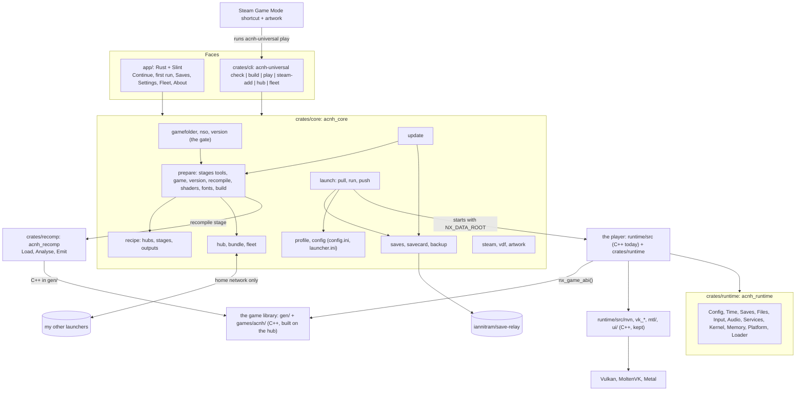

# Code map: ACNH Universal

The intended shape of the repo for 1.0 (`SPEC.md`, approved 2026-11-02): **one Rust engine, two faces, one recompiler, one runtime, three hubs, five platforms**. The engine (`crates/core`, library `acnh_core`) checks my game folder and its version, prepares a build for each device family on a hub, serves it to my other devices over the home network, writes the Steam shortcut with artwork, and wraps every start in a save-relay pull and push. The recompiler (`crates/recomp`, `acnh_recomp`) turns `exefs/main` into the C++ the game library is built from, replacing upstream's `recomp/` (Python). The runtime (`crates/runtime`, `acnh_runtime`) is the host side, replacing `runtime/src` outside the renderer one group of files at a time (ADR 0002), behind the C ABI the game library already uses (`runtime/include/nx/game.h`, `nx_game_abi()`). The NVN renderer, `games/acnh/` and the in-game overlay stay C++ (ADR 0001). The faces are the Slint launcher (`app/`, ADR 0003) and the `acnh-universal` command line (`crates/cli`). Android keeps upstream's route (ADR 0005); Mac, iPhone and iPad build the same recompiled code (ADR 0006).

Status per module: **present** (built), **stub** (the final types and signatures exist; constants and trivial pure helpers may be built, and any other function returns `Err(Error::NotBuilt(..))` or panics with "not built yet: <what>" when it cannot fail), **planned** (not in the tree), **legacy** (upstream's C++ or Python that we replace, removed when its Rust replacement is present and the game builds and boots). "Musts" columns cite `SPEC.md` (M1-M15); every module that replaces C++ or Python also serves M13. An issue that builds a module moves its status in the same PR. Integration branch: `main`.

## Platforms (R04)

| Device family | 1.0 device | Game code | Renderer | Built on (hub) | Launcher | Save sync in | CI |
|---|---|---|---|---|---|---|---|
| Linux / SteamOS | the AMD handheld, the Strix Halo tablet | recompiled, x86-64 | NVN on Vulkan (RADV) | the Strix Halo tablet; the AMD handheld pulls | Slint app (AppImage), opened by the Steam shortcut | the launcher | self-hosted Linux: workspace, game-data check and the Android cross-build (now); C++ tests (0.01); boot smoke (4.01) |
| Windows | the RTX 3090 Ti desktop | recompiled, x86-64 | NVN on Vulkan | the desktop | Slint app | the launcher | self-hosted Windows: workspace (now); the C++ build (7.01) |
| macOS | a Mac with Apple silicon | recompiled, ARM64 | MoltenVK, then upstream's Metal | the Mac | Slint app (also builds and installs the iOS app) | the launcher | `macos-latest` on request (paid minutes) until the Mac runner is online |
| iOS / iPadOS | iPhone or iPad + controller | recompiled, ARM64 (no JIT) | Metal (or MoltenVK) | the Mac, installed by cable | none: the game app | the game app (save-relay C interface) | `cargo check` for `aarch64-apple-ios` in the macOS job, on request until the Mac runner is online (now) |
| Android | Adreno device + controller | recompiled, ARM64 | NVN on Vulkan (Turnip) | the Strix Halo tablet | Slint app, same APK as the player | the launcher | self-hosted Linux: `aarch64-linux-android` cross-build, NDK 28.2.13676358 on the runner (now) |

Rules that keep it portable: `crates/core` is pure Rust (no C library, no OpenSSL; the hub's crates are `mdns-sd`, RustCrypto `spake2`, `chacha20poly1305`, `sha2`, behind feature `hub`); no `std::os::*` outside `platform` and `steam`; every OS rule takes its folders from `platform::Vars`, so Linux, Windows and Mac rules are tested on every runner; tests build temporary folders under `std::env::temp_dir()` and never read a real game file. `crates/core` has `#![forbid(unsafe_code)]`; the runtime is the only crate with `unsafe` and FFI, and each `unsafe` block carries a `// SAFETY:` line.

## How it fits together



## Modules: `crates/core` (`acnh_core`)

| Module | Status | Owns | Replaces | Musts |
|---|---|---|---|---|
| `error` | present | `Error` with a stable `code()` and a plain message per variant, `NotBuilt`, `not_built`, `Result`; messages name files, never their contents | | all |
| `platform` | present | `Os` (linux, windows, mac, ios, android) with `key`/`from_key`, `Vars` (home, data, config from an env lookup), `AppDirs` (`<config>/acnh-universal`; `<data>/acnh-universal`: `install/`, the data root `install/root`, logs `install/logs`) | the folder code of `launcher/files.cpp` | M1, M2, M13 |
| `version` | present | `Version` (3.0.2, 3.0.3, 2.0.7, 1.0.0) with name, build id, `native60` and `from_name`; `RECOMMENDED`; `from_build_id`, the gate that refuses any other build with a message naming the four | `tools/acnh_version.py`, `games/acnh/versions.txt` (read) | M1 |
| `nso` | present | `build_id` from the first 0x60 bytes of `exefs/main` (magic `NSO0`, 16 bytes at 0x40, upper hex), `read_build_id` | the header read of `tools/acnh_version.py` and `launcher/files.cpp` (`build_id`) | M1, M14 |
| `gamefolder` | stub | `GameFolder` (root, `exefs/`, `romfs/` or `extract/romfs/`, `aoc/<index>/` sorted, `from_importer`, version), `check` naming the first missing file | `find_game`, `from_importer` in `tools/setup_acnh.py`; `game_parts` in `launcher/files.cpp` | M1 |
| `config` | present | `Config` of `Line`s: `parse`, `get` (last wins), `set` (in place, else appended), `to_text`; `config.ini` in the data root and `launcher.ini` in the settings folder | `runtime/src/config.cpp` (format), the ini code of `launcher/files.cpp` | M2 |
| `profile` | present | `DeviceProfile` (amd-handheld 30 fps, strix-halo-tablet 60 fps, desktop), `builtin`, `by_id`, `detect` from the CPU model; settings as `config.ini` entries, power as advice only | | M2 |
| `recipe` | stub | `Hub` (strix-halo, desktop, mac), `hub_for`, `serves`, `hub_by_key`; `Stage` (tools, game, version, recompile, shaders, fonts, build) with `from_line` for `== <stage>` progress lines; `output` per target (`acnh`, `acnh.exe`, `ACNH.app`, `ACNH.ipa`, `acnh.apk`) | the stage list of `tools/setup_acnh.py`, the progress parsing of `launcher/pipeline.cpp` | M1, M11 |
| `prepare` | partial | `Request`, `Step` (`Rust`, or upstream's `Script` until a stage is ported), `step` (stub), `prepare` (stub; stages in order, each skipped when its output is there), `redact` (present: no home folder or stray hex ids in a log line) | `tools/setup_acnh.py` and the scripts it runs: `nso2bin.py`, `pack_romfs.py`, `pack_spirv.py`, `extract_shaders.py`, `sarc_endian.py`, `msg_rewrap.py` (1.27-1.31); `launcher/pipeline.cpp` | M1, M13, M14 |
| `saves` | stub | `save_dir` (`<data root>/user/device_save`), `backups_dir` (`user/backups`), `REQUIRED`, `is_synced` (what travels), `check_island`, `relay_manifest` (save-relay's manifest for ACNH) | the save folder of `runtime/src/saves.cpp` (read, not moved; the runtime's own `Saves` group is 4.04) | M6 |
| `savecard` | stub | `SaveCard` (save time from `main.dat`, device, play time, version, picture), `read_card` from `<save_dir>/../launcher-card.txt`, `latest`, `side_by_side` for a conflict | | M10 |
| `backup` | stub | `stamp` (`YYYYmmdd-HHMMSS`, UTC), `backup_saves` (the synced files), `list`, `prune` (`KEEP` = 10) | the backups of `runtime/src/saves.cpp` (same place and shape) | M7 |
| `update` | stub | back the island up, rebuild, check it is still there | | M7 |
| `launch` | stub | `Relay` and `Game` traits, `Sync`, `Keep`, `play` (pull, conflict with both cards, run the player with the profile, push) | starting the player in `launcher/desktop.cpp` | M6, M10 |
| `bundle` | stub | `Bundle` (target, version, commit, build id, files with size and SHA-256), `DEVICE_OWNED` (`root`, `logs`), `is_forbidden` (never game data, the game library, packs, `gen/`, saves), `to_text`/`from_text`, `manifest`, `verify`, `install` (keeps `DEVICE_OWNED`) | | M11, M14 |
| `fleet` | present | `DeviceRecord` (device, os, version, build id, last sync, free space), `Drift`, `drift`, `warning`, `to_line`/`from_line` | | M11 |
| `hub` | present (feature `hub`) | `is_home_network` (loopback, private, unique-local, and link-local ranges); planned: `discover` (mDNS `_acnh-universal._tcp`), `pair` (six-digit code, SPAKE2), `serve`, `pull` (sealed, resumable), the game data transfer to my own paired devices, a `Transport` trait for loopback tests | | M11 |
| `vdf` | present | Steam binary KeyValues `Value`, `write`, `read` (depth limit `MAX_DEPTH` = 64) | | M2 |
| `steam` | stub | `crc32`, `shortcut_app_id`, `rungameid`, `Shortcut::quoted_exe`, `Shortcut::app_id`, `userdata_roots`, `shortcut_entry`, `upsert` are present; `write_shortcut` remains a stub (Steam closed, `.bak` kept); the shortcut runs `acnh-universal play` | the desktop and Start-menu shortcuts of `launcher/desktop.cpp` and `tools/install_mac_shortcut.sh` (the Steam entry is new) | M2 |
| `artwork` | present | `Art` (grid, wide grid, hero, logo, icon), `file_name`, `size`, `grid_dir`, `paths`; made from the game folder's icon, else `assets/acnhrecomp.png`; nothing downloaded | | M2 |
| `relay` | planned (feature `relay`) | the save-relay adapter: links its library, maps outcomes to `launch::Sync`; waits on iannitram/save-relay#49 | | M6 |

`platform`, `vdf`, `steam`, `artwork`, `backup`, `bundle`, `fleet`, `launch`, `update`, `hub` and the shapes of `savecard`, `profile` and `recipe` are copied from iannitram/totk-universal (MIT) with credit in the file header, by their issues.

## Modules: `crates/recomp` (`acnh_recomp`)

Ported pass by pass (ADR 0002). Each pass's output must match `python3 -m recomp` byte for byte on the same hand-written AArch64 input (never game code); `tests/difftest.py` (Unicorn) stays the oracle. Until a pass is ported, `prepare` runs upstream's tool for the recompile stage.

| Pass | Status | Replaces (lines) | Order | Musts |
|---|---|---|---|---|
| `Load` | planned | `recomp/nso.py` (200): segments, symbols, relocations | 3.01 | M13 |
| `Analyse` | planned | `recomp/analysis.py` (439), `recomp/ehframe.py` (142): functions and their bounds | 3.02 | M13 |
| `Emit` (integer, branches) | planned | `recomp/emit.py` (659), `emit_int.py` (421), `regcache.py` (218) | 3.03 | M13 |
| `Emit` (FP, NEON) | planned | `emit_fp.py` (255), `emit_neon.py` (312), `emit_neon_wide.py` (369), `emit_vldst.py` (92), `emit_ext.py` (249), `emit_sdk20.py` (129) | 3.04 | M13 |
| driver | planned | `recomp/__main__.py` (303), `stats.py` (48) | 3.05 | M13 |

## Modules: `crates/runtime` (`acnh_runtime`)

Built as a static library linked into the player while C++ remains; each Rust group exports the same `extern "C"` symbols as the files it replaces (header from `cbindgen`). Order is `SERVICES`: leaves first, the loader last. Each step keeps the boot smoke test green and is followed by a device check on the AMD handheld.

| Group | Status | Replaces (`runtime/src/`) | Order | Musts |
|---|---|---|---|---|
| scaffold | planned | the CMake build of `runtime/` driven from `build.rs`; the boot smoke test | 4.01 | M13, M15 |
| `Config` | stub (listed) | `config.cpp`: `config.ini` to the `NX_*` settings | 4.02 | M2, M13 |
| `Time` | stub (listed) | `hle_time.cpp`, `svc_time.cpp`: the island clock (`NX_TIME_OFFSET`) | 4.03 | M12, M13 |
| `Saves` | stub (listed) | `saves.cpp`, `users.cpp`, `svc_account.cpp` | 4.04 | M6, M13 |
| `Files` | stub (listed) | `hle_fs.cpp`, `game_folder.cpp`, `mod_fetch.cpp`: the romfs, its packs, mods | 4.05 | M13 |
| `Input` | stub (listed) | `hle_hid.cpp`, `input_script.cpp`, `touch_layout.cpp` | 4.06 | M3, M5, M9, M13 |
| `Audio` | stub (listed) | `hle_audio.cpp` | 4.07 | M13 |
| `Services` | stub (listed) | `svc_am.cpp`, `svc_set.cpp`, `svc_misc.cpp`, `svc_process.cpp`, the other `hle_*.cpp` (bcat, friends, ldn, movie, net, nfp, ngc, pl, ro, vi) | 4.08 | M13 |
| `Kernel` | stub (listed) | `kernel.cpp`, `ipc.cpp`, `kernel_watch.cpp` | 4.09 | M13 |
| `Memory` | stub (listed) | `memory.cpp`, `memguard_*.cpp`, `write_watch.cpp`: the guest address space (on Apple at `APPLE_GUEST_SHIFT`, heap up to 6 GiB) | 4.10 | M4, M5, M13 |
| `Platform` | stub (listed) | `platform_*.cpp`, `thermal.cpp`, `perf_hint.cpp` | 4.11 | M13 |
| `Loader` | stub (listed) | `loader.cpp`, `game_abi.cpp`, `main.cpp`: load the game library and start it | 4.12 | M13 |

"Stub (listed)": the group is named in `SERVICES` and `ported` says false; no code moves until its issue. The rest of `runtime/src` outside the renderer (`bug_report.cpp`, `frame_stats.cpp`, `discord_presence.cpp`, `cpu_profile.cpp`, `sampler.cpp`, `glyphs.cpp`, `app_icon.cpp`) goes with the group that calls it, or stays C++ beside the overlay when it is overlay code.

## Faces

| Path | Status | Owns | Replaces | Musts |
|---|---|---|---|---|
| `crates/cli` (`acnh-universal`) | stub | `check`, `build`, `play`, `steam-add`, `hub serve/pair/pull`, `fleet`; the Steam shortcut runs `play` | `tools/setup_acnh.py`'s command line, `tools/launcher.sh` | M1, M2, M6, M11 |
| `app/` (`acnh-app`) | planned | the launcher, Rust + Slint, Linux, Windows, macOS, Android; links `acnh_core` | `launcher/` (SDL3 + ImGui: `main.cpp`, `desktop.cpp`, `pages.cpp`, `pipeline.cpp`, `files.cpp`) | M2, M4, M9-M11, M13 |
| `app/src/vm/` | planned | view models: `continue_page`, `first_run`, `saves`, `settings`, `fleet`, `about` | | M8, M10, M11 |
| `app/src/input.rs` | planned | `Nav` from gilrs (desktop) and Android key events | | M9, M10 |
| `app/ui/` | planned | `.slint` pages, controller first | `launcher/pages.cpp` | M10 |
| `docs/design/continue-screen.md` | planned | the Continue screen brief, shared with totk-universal | | M10 |

## Upstream code that stays (C++ or Java, behind a C ABI)

| Path | Owns | Musts |
|---|---|---|
| `runtime/src/nvn/`, `vk_*.cpp`, `runtime/src/mtl/` | the NVN renderer on Vulkan, MoltenVK and Metal | M2-M5, M9 |
| `runtime/src/ui/` | the in-game settings overlay | M2 |
| `games/acnh/` | the per-game C++ the recompiled code links with, `versions.txt` | M1 |
| `gen/` (made on a hub, never committed) | the recompiled game code | M1, M14 |
| `android/` | the APK shell (`Home.java`), Gradle; our launcher joins it at 9.01 | M9 |
| `tools/build_turnip.sh`, `tools/build_android.sh` | Turnip and the Android build | M9 |
| `tests/*_test.cpp`, `tests/difftest.py`, `tests/astc_check.py`, `tests/metal_shader_check.mm` | the renderer's tests and the recompiler's oracle | M15 |
| `tools/check_no_game_data.sh` | the pre-commit and CI game-data check | M14 |

## Legacy (removed by M13)

| Path | Removed when |
|---|---|
| `launcher/` (C++, SDL3 + ImGui, about 3.6k lines), `tools/launcher.sh` | the Slint app has parity: Continue, first run, Settings, Add to Steam, update (2.10) |
| `tools/setup_acnh.py` (633), `tools/setup_acnh.sh`, and the scripts it runs: `acnh_version.py`, `nso2bin.py`, `pack_romfs.py`, `pack_spirv.py`, `extract_shaders.py`, `sarc_endian.py`, `msg_rewrap.py` | every `prepare` stage is `Step::Rust` (1.31) |
| `recomp/` (Python, about 3.8k lines) | the recompile stage runs `crates/recomp` (3.05) |
| `runtime/src` outside the renderer and the overlay | the `Loader` group is Rust and the game boots (4.12) |
| `tools/package_release_*.sh`, `tools/release_readme.sh` | the release workflow builds the Rust app (2.09) |

Debug tools that never ship (`tools/find_*.py`, `capture*.ps1`, `probe.py`, `symbolize.py` and the like) may stay (M13).

## Build and test

```sh
cargo build --workspace
cargo test --workspace
cargo test --workspace --all-features    # with the hub
python3 tools/setup_acnh.py --help       # upstream's build, until 1.31
```

CI (M15): `.github/workflows/check.yml` runs fmt, clippy and test, with and without `--all-features`, on the self-hosted Linux and Windows runners, the game-data check over every tracked file, the Android cross-build (`aarch64-linux-android`), and macOS on request (with the iOS check, `aarch64-apple-ios`); `build.yml` is upstream's release build. Not in CI yet: the C++ tests (0.01), the boot smoke test (4.01).

## Build hubs (ADR 0004)

| Hub | Builds for | Clients |
|---|---|---|
| the Strix Halo tablet | linux, android | itself, the AMD handheld, the Android device |
| the RTX 3090 Ti desktop | windows | itself |
| the Mac | mac, ios | itself; the iPhone or iPad by cable |

A bundle holds the player a hub built (its files, sizes and hashes), never game data: not the game folder, not the game library, `romfs.pak`, `spirv.pak` or `gen/`, not a save. The game data a prepare made goes to my own paired devices separately, over the home network only (5.04), and lands in the data root, which `bundle::install` keeps. Nothing leaves the home network.

## Not verified yet

- The four build ids are upstream's (`games/acnh/versions.txt`); each is confirmed by a real build on a hub (6.01).
- Whether the guest's fixed 39-bit address reservation fits an iPhone or iPad, with which entitlement, and what a free Apple ID allows (8.01).
- How long an upstream sync takes once `recomp/` and `runtime/src` are Rust; measured at stages 3 and 4.
- The play time on the save card: written by the launcher to `launcher-card.txt` after each session, since the game's own count needs a save reader (after 1.0).
- mDNS from Game Mode and on Android (multicast lock).
