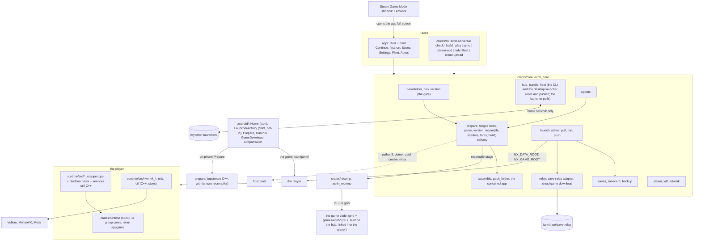

# Code map: ACNH Universal

The shape of the repo against 1.0 (`SPEC.md`, approved 2026-11-02; M5 widened and approved again 2026-11-17; M4 and the Dropbox exception changed and approved again 2026-11-18; M18, M4 and the Dropbox exception changed so Android and iPhone/iPad may download the game at first start from my own Dropbox, and approved again 2026-11-23, #232): **one Rust engine, two faces, one recompiler, one runtime, three hubs, five platforms**. The engine (`crates/core`, library `acnh_core`) checks my game folder and its version, prepares a build for each device family on a hub, serves it to my other devices, writes the Steam shortcut with artwork, and wraps every start in a save-relay pull and push. The recompiler (`crates/recomp`, `acnh_recomp`) turns `exefs/main` into the C++ the game library is built from. The runtime (`crates/runtime`, `acnh_runtime`) is the host side behind the C ABI the game library uses (`runtime/include/nx/game.h`, `nx_game_abi()`), with C++ still around it (see its section). The NVN renderer, `games/acnh/` and the in-game overlay stay C++ (ADR 0001). The faces are the Slint launcher (`app/`, ADR 0003) and the `acnh-universal` command line (`crates/cli`). Android keeps upstream's route (ADR 0005); Mac, iPhone and iPad build the same recompiled code (ADR 0006).

**How to read the status column.** **present**: built and reached by a face or a build. **partial**: built, with a named gap. **library only**: built and tested, but no face or build step reaches part of it. **legacy**: upstream's C++ or Python that M13 says we replace. **stays**: C++ or Java that SPEC M13 names as staying. A status that an open issue qualifies carries the issue number. "Musts" cite `SPEC.md` (M1–M18). An issue that changes a module moves its row in the same PR.

**How this map was checked.** Against `main` at `dc87368` on 2026-11-25, by reading: eight readers over the whole tree, then a second, independent read of each of 43 findings (17 held as stated, 26 held with corrections, none was refuted). Nothing was built or run for it. It now describes `main` at `b126c53` (2026-11-26, the merge of PR #438): the rows that the merges of 2026-11-26 changed were revised from their diffs and descriptions and spot-checked by reading, not built. The last ones were the Android `Home` change (PR #423, #363), the Mac's first pull from save sync (PR #430, #429: `backup`, `update`, `savecard`, `relay`, `error`, the CLI, `relay_setup`, `continue_page`, the Mac Info.plist), the docs outside this map (PR #422), the `steam_artwork` test (PR #426) and `relay::open`'s doc comment (PR #438). Open pull requests (see `ROADMAP.md`, Open pull requests) are not reflected in any row until they merge. The work the audit found is in `ROADMAP.md` (issues #321–#370).

## Size, by language

Tracked first-party lines outside `private/` and `third_party/` (counted on 2026-11-25, not recounted since):

| Language | Lines | Files | Where |
|---|---|---|---|
| C++ and headers | 146,871 | 276 | `runtime/` 132,120 (most of it the renderer); `prepare/` 11,773; `tests/` 1,876; `games/` 951 |
| Rust | 79,707 | 163 | `crates/` 66,373; `app/` 13,334 |
| Python | 4,964 | 50 | `tools/` 4,207; `tests/` 665 |
| Java | 4,344 | 17 | `android/` |
| Shell | 3,049 | 32 | `tools/` 2,047; `tests/` 933 |
| C# | 2,208 | 6 | `tools/maxwell/spirv_harness` |
| CMake | 1,148 | 4 | `CMakeLists.txt` 883; `prepare/` 265 |
| Slint | 967 | 7 | `app/ui/` |
| Objective-C++ | 851 | 2 | `runtime/src/appgame_ios.mm` 766; `tests/` 85 |
| PowerShell | 390 | 4 | `tools/` (developer capture tools) |

## Platforms (R04)

| Device family | 1.0 device | Game code | Renderer | Built on (hub) | Front door | Save sync | CI |
|---|---|---|---|---|---|---|---|
| Linux / SteamOS | the AMD handheld, the Strix Halo tablet | recompiled, x86-64 | NVN on Vulkan (RADV) | the Strix Halo tablet; the AMD handheld is meant to pull (publish and serve merged, #357; still blocked on #358) | Slint launcher; the release is an AppImage and `pack_folder` makes the contained folder on the device (#191) | the launcher: Nextcloud, Google Drive or Dropbox | ubuntu-24.04: the workspace, the save-relay link check, the game-data check, the pins and `cargo deny`, the Rust emitter smoke test and Unicorn oracle, C++ unit tests, the game-root and source-package checks, the fake-game boot, the Android cross-build (see the CI table) |
| Windows | the RTX 3090 Ti desktop | recompiled, x86-64 | NVN on Vulkan | the desktop | Slint launcher; a zip, and `pack_folder` makes the contained folder (#190) | the launcher | windows-2025: the Rust workspace. `cpp-windows` (C++ and the player, LLVM 23.1.3) has passed since #322 |
| macOS | a Mac with Apple silicon + controller | recompiled, ARM64 | MoltenVK, then upstream's Metal | the Mac | Slint launcher inside `ACNH-Universal.app`; Prepare makes the contained Mac app and both `.ipa`s into Dropbox | the launcher | macos-15: the workspace with all features, the MoltenVK assemble test, the layout tests, the Mac package test and its Info.plist keys, the staging and `build_common` tests. The Mac player is built in CI (arm64, Homebrew SDL3), not run |
| iOS / iPadOS | iPhone or iPad + controller | recompiled, ARM64 (no JIT) | Metal (or MoltenVK) | the Mac, by Prepare's `ios` target: `ACNH-Universal-<version>.ipa` with the game inside, and a small one with no game in `ios/small/` plus its game folder; installed with SideStore | the game app itself | in the player through save-relay's Rust API: Nextcloud or Dropbox (#361 / PR #376; not tried on a device) | macos-15: the Rust target check, the runtime static library, C++ compile for both SDKs, stub bundles and their checks, Prepare's `ios_real` test, the stub `.ipa` and `tests/package_ios_test.sh` |
| Android | an Adreno device + controller (none named yet); my Pixel Fold (Mali-G710) for information | recompiled, ARM64 | NVN on Vulkan: on Adreno the bundled Turnip (the system driver on Adreno 8xx), elsewhere the device's own driver | the Strix Halo tablet (ADR 0004); Prepare's `android` target is broken for a prepared folder (#365); upstream's on-phone Prepare also builds it on the phone | `Home` (upstream's Java shell: folder picker, on-phone Prepare, hub pull, Dropbox download, start) is the launcher activity and the shortcut target (#363); `LauncherActivity` (the Slint launcher) is not exported and is packed only by `build_android.sh --launcher` | in the app through save-relay's C interface and JNI: **Dropbox only** | ubuntu-24.04: `cargo build --locked --workspace --target aarch64-linux-android`, then the Slint launcher's cdylib (`-p acnh-app --features android-launcher --lib`), and `tests/android_app_check.sh`, which also asserts that `Home` is the only MAIN/LAUNCHER activity and the only owner of the shortcuts, that `LauncherActivity` is not exported, and that every shortcut targets `Home` (#363). No APK, no Android C++ |

### Where each platform keeps the game and saves

`plat::game_root()` (`runtime/src/game_root.h`) is `NX_GAME_ROOT` when set; else, on macOS and iOS, `game/` beside SDL's base when it holds `analysis/main.bin`; else, on iOS, the game the small `.ipa` downloaded; on Android `<files>/game` when it holds `analysis/main.bin`; else the data root. The launcher starts the player with `NX_DATA_ROOT`, `NX_LOG` and `NX_GAME_ROOT` (`app/src/player_env.rs`).

| Platform | The game (read-only) | Saves and settings | How the game gets there |
|---|---|---|---|
| Linux, Windows | `ACNH-Universal/game/` in the contained folder; after a local Prepare the prepared folder (`<data>/acnh-universal/prepare`) | `<data>/acnh-universal/install/root/`: `user/device_save`, `user/backups`, `config.ini`. It sits inside the install folder a hub pull replaces; `bundle::install` moves `root/` and `logs/` into the new install and `recover_install` restores them after a kill (#340) | Prepare on the device. A pull from a hub brings the player only (#358). The cloud download (#321) |
| macOS | `ACNH-Universal.app/Contents/Resources/game/` | `~/Library/Application Support/ACNH-Universal` (`user/`, `config.ini`, `logs/`) | inside the zipped app Prepare delivers to `<dropbox>/_transfers/ACNH-Universal/mac/` |
| iOS / iPadOS | `ACNH.app/game/`, or `Library/Application Support/game/` with the small `.ipa` | the app's Documents folder (`user/`, `config.ini`, `logs/nx.log`); save-relay's config in `Library/save-relay` | inside the `.ipa` in `<dropbox>/_transfers/ACNH-Universal/ios/`; or downloaded at first start from `Apps/save-relay/acnh-universal-game/ios/` (I upload `ios/small/acnh-universal-game/ios/` there by hand) |
| Android | `<files>/game/` (`analysis/`, `romfs.pak`, `spirv.pak`, `fonts/`, `aoc/`, `libacnh_game.so`) | `<files>/root/`; never in a cloud backup or device transfer (`allowBackup="false"`, `res/xml/data_extraction_rules.xml`) | downloaded from `Apps/save-relay/acnh-universal-game/android/` (put there by `tools/stage_dropbox_game.sh` or by hand: Prepare's `android` target writes to `_transfers/ACNH-Universal/android/`, which the app does not read, #365); pulled from a hub (`HubPull.java`); prepared on the phone (`Prepare.java`); or copied from a folder on the device |

`<dropbox>` is `launcher.ini`'s `dropbox` key, else `Dropbox` in the home folder (`prepare::delivery_folder`). The Mac hub's Prepare writes both Apple targets into one prepared folder, `<data root>/prepared/`.

Rules that keep it portable: `crates/core` links no C library and no OpenSSL (the hub's crates are `mdns-sd`, RustCrypto `spake2`, `chacha20poly1305`, `sha2`, behind feature `hub`) and has `#![forbid(unsafe_code)]`; it does run host programs (see [What Prepare needs on a hub](#what-prepare-needs-on-a-hub)). No `std::os::*` outside `platform` and `steam` except `#[cfg(unix)]` file modes and tests; every OS rule takes its folders from `platform::Vars`, so Linux, Windows and Mac rules are tested on every runner; tests build temporary folders and never read a real game file. The runtime holds the `unsafe` and FFI, apart from the Android app's JNI entry and device query (`app/src/android_launcher.rs`, `app/src/input/android.rs`).

## How it fits together



## Modules: `crates/core` (`acnh_core`)

| Module | Status | Owns | Musts |
|---|---|---|---|
| `error` | present | `Error` with a stable `code()` and a plain message per variant (`RelayUnreachable`, `RelaySignIn`, …); messages name files, never their contents. `RelaySignIn` is a rejected credential; a missing one is not a variant but `Error::Saves(relay::SIGN_IN_MISSING)`, compared by equality (`crates/cli/src/sync.rs`). `NotBuilt` and `not_built!` were removed (PR #408) | all |
| `platform` | present | `Os` with `key`/`from_key`; `Vars`; `AppDirs::for_os` (`<config>/acnh-universal`; `<data>/acnh-universal` with `install/`, the data root `install/root`, logs `install/logs`; on the Mac both are `~/Library/Application Support/ACNH-Universal`); `atomic_write`, `atomic_write_with` (#245); `link_dir`, `unlink_dir`, `is_dir_link` | M1, M2 |
| `version` | present | `Version` (3.0.2, 3.0.3, 2.0.7, 1.0.0) with name, build id, `native60`, `from_name`; `RECOMMENDED`; `from_build_id`, the gate that refuses any other build | M1 |
| `nso` | present | `build_id` from the first 0x60 bytes of `exefs/main`, `read_build_id` | M1, M14 |
| `nso2bin` | present | `parse` (pure-Rust `lz4_flex`), `Nso::image`, `write` (through `platform::atomic_write`, PR #373) | M1, M13 |
| `gamefolder` | present | `GameFolder` (root, `exefs/`, `romfs/` or `extract/romfs/`, `aoc/<index>/`, `from_importer`, version), `check` naming the first missing file | M1 |
| `config` | present | `Config` of `Line`s: `parse`, `get` (last wins), `enabled`, `set`, `to_text`; `config.ini` in the data root and `launcher.ini` in the settings folder | M2 |
| `profile` | present | `DeviceProfile` (amd-handheld 30 fps, strix-halo-tablet 60 fps, desktop), `builtin`, `by_id`, `detect`; settings as `config.ini` entries | M2 |
| `recipe` | present | `Hub` (strix-halo, desktop, mac), `hub_for`, `serves`, `hub_by_key`; `Stage` (tools, game, version, recompile, shaders, fonts, build) with `from_line`; `output` per target; `MAC_APP` | M1, M11 |
| `prepare` | partial (#335, #336, #365) | See [Prepare](#prepare) below. `prepare/`: ten files, 4,128 lines (`mod`, `runner`, `tools`, `game`, `recompile`, `shaders`, `build`, `deliver`, `toolchain`, `redact`; PR #408) | M1, M13, M14, M18 |
| `pack_folder` | present | The contained Linux and Windows app folder (#191, #190): `app_out_dir`, `app_out_dir_for`, `PackContext`, `pack_folder_with`, the `app_dir` key in `launcher.ini`, `check_prepared`, refusal inside a git work tree; it rebuilds a pack without a current key through `prepare::pack_prepared` when the game's RomFS is at hand (PR #373) | M2, M3, M18 |
| `assemble` | present | After the build stage, the self-contained player (1.22b): `assemble`, `Plan`, `assemble_with` behind a `Tools` seam (`patchelf`, `install_name_tool`, `codesign`). Linux: `acnh` and the libraries a stock system may lack beside it, found through `$ORIGIN`. Windows: `acnh.exe` and the DLLs it imports. Mac: `ACNH-Universal.app` with `Contents/MacOS/acnh`, the Vulkan loader and MoltenVK in `Contents/Frameworks`, an ad-hoc signature, arm64 only, refused inside a git work tree. `player`: the program a launcher starts. The recompiled code is linked into the player; no game library is shipped on desktop | M1, M4, M11, M14 |
| `appgame` | present | The phone game download and Android's private storage layout. `install`, `install_with` (copy a prepared folder into `<files>/game/`); `Manifest`, `ManifestFile` (`manifest.json`: `version`, `build_id`, `nx_game_abi`, each file's path, size and SHA-256; a hand-written JSON parser); the blocking `DownloadTransport` trait and `download` (resume over `game.partial/`, hash check with one refetch, free-space check, one rename, read-only); `partial_bytes`, `verify_partial`, `install_partial` for iOS's background session; `sha256_file`. Used by the desktop cloud download and by iOS. **Android's download does not use it**: `GameDownload.java` is its own implementation (#367) | M14, M18 |
| `msg` | partial (#335) | Reflows extracted dialogue, mail and tutorial messages for the pt-BR mod (1.30): SARC order, MSBT sections and UTF-16 control tags preserved, archives replaced as a batch. Font advances come from a **Python Pillow probe** on the system Python and compression from the `zstd` program; when either is missing the reflow stays pending (nothing installed) with a message naming the tool, so the next Prepare retries it (#334 / PR #388) | M1, M13 |
| `pack` | present | `romfs`, `romfs_range`, `romfs_size`, `spirv` write the `NXRP` and `SPK1` packs. Both write a temp file, sync and rename, so a killed run leaves the old pack; the deliver paths rebuild a pack whose key record is missing (#333 / PR #373) | M1, M13 |
| `sarc` | present | Parse and rewrite endian-aware SARC archives; `fix_archives` (an error naming `zstd` when there are archives and `zstd` cannot run, PR #388) | M1, M13 |
| `shaders` | partial (#335) | `plan`, `extract`, `cleanup`, `Runner`, `stage_with`: plan and extract shader groups by running **`tools/maxwell/containers.py`, `exefs_shaders.py` and `model_shaders.py`** on the system Python, find a .NET 10 SDK and the harness (`tools/maxwell/spirv_harness`, built to `private/build/spirv_harness/`), translate with optional SPIR-V validation, check the summary. When the extract summary has failed groups `extract` returns an error, so `.shaders.key` is not written and the next run extracts again (PR #388). On macOS the translator runs with `DOTNET_TieredCompilation=0` and `DOTNET_EnableWriteXorExecute=0` | M1, M13 |
| `glyphs` | present | The shared button TrueType font and the ParkExt rewrite for Xbox, PlayStation and Switch layouts (`button_font`, `controller`, `geometry`, `truetype`, `variants`); uses the `zstd` program; writes no `shared.ttf` when no host font is found | M1, M5, M13 |
| `saves` | present | `save_dir` (`<data root>/user/device_save`), `backups_dir`, `REQUIRED`, `is_synced`, `check_island`, `relay_manifest` | M6 |
| `savecard` | present | `SaveCard` (save time, device, play time, version, picture), `read_card` from `launcher-card.txt` (the relay's `saved` and `file_modified_ns` lines override the `main.dat` time), `latest`, `side_by_side` (the date as `YYYY-MM-DD HH:MM UTC`; local time is #433), `readable_stamp` (save-relay's RFC 3339 stamp, `2026-11-24T17:39:43Z`, in the card form `2026-11-24 17:39 UTC`; anything else unchanged; used by Continue's held message) | M10 |
| `backup` | partial (#337) | `stamp` (UTC), `is_stamp`, `backup_saves`, `backup_saves_pruned`, `backup_before_replacing` (what the launcher's Play anyway and keep-the-relay's-island and the CLI's `--keep relay` call: `None`, writing nothing, when the save folder does not exist, as on a device that never played; otherwise `backup_saves_pruned`), `list`, `prune` (`KEEP` = 10): flat `user/backups/<stamp>/`. `list` and so `prune` count only `YYYYmmdd-HHMMSS` names, so the game's own `<island> <hash>/<stamp>/` folders are left alone (PR #386; the runtime's stamp is UTC too). The two layouts are still two | M7 |
| `update` | present | `update` backs up, prunes, rebuilds, checks the saves afterward and reports the backup on failure; with no save folder yet (a device that never played) it only runs `rebuild` and returns `Updated { backup: None, files_before: 0, files_after: 0 }` (`Updated.backup` is an `Option<PathBuf>`). The only caller of `prune` | M7 |
| `launch` | present | `Relay` and `Game` traits; `RelayStatus` (Ready, RelayNewer, LocalNewer, Held, Unavailable, Conflict, Off); `Sync`, `Keep`, `Played`; `play` (pull, conflict with both cards, run, push). `Sync::Offline` at the pull refuses play (#168) | M6, M10 |
| `bundle` | present | `Bundle` (target, version, commit, build id, files with size and SHA-256), `DEVICE_OWNED` (`root`, `logs`), `is_forbidden`, `to_text`/`from_text`, `manifest`/`verify`, `check_sizes` (existence and size only, for the window thread), `install`, `recover_install`. `install` renames the install to `.old`, moves the new one in, then moves `root/` and `logs/` over, so the island is in `.old` or in the install at every step; `recover_install` (also called at the start of `play`) finishes an interrupted install (#340 / PR #394). `hub::publish_build` calls `manifest` | M11, M14 |
| `fleet` | present | `DeviceRecord`, `Drift`, `drift`, `warning`, `to_line`/`from_line` | M11 |
| `hub` (feature `hub`) | partial (#358) | `is_home_network`; `announce`, `discover` (mDNS `_acnh-universal._tcp`, `SERVICE`); `Transport`, `TcpTransport`, `MemoryTransport`; `PairingSession`, `pair`/`pair_in` (six-digit SPAKE2; `MAX_FAILED_ATTEMPTS` = 3, `CODE_LIFETIME` = 5 min; `generate_code` makes the code), `read_peers`, `remove_peer`; `serve`/`pull` (sealed, chunked: `CHUNK_SIZE` 64 KiB, `IO_TIMEOUT` 5 min); `Found`, `Peer`, `Clock`. `hub/publish.rs` (#357 / PR #378): `publish_build` seals an install into `builds/<build id>/` with `bundle.txt` written last (the newest two builds per target are kept) and `resume_dir`, the stable `<data>/.hub-pull` cache. `hub/host.rs`: `HubHost` announces and serves with a generated code that is replaced when used up or expired, one thread per connection (at most 32), a failed accept skipped, a bad `bundle.txt` skipped by `newest` (#359 / PR #379). `hub/prepared.rs`: `serve_prepared`/`pull_prepared`, the prepared-data protocol, **Android targets only** and not resumable; `lock_install_and_sweep` takes the install lock and removes stale staging folders. `hub/service.rs`: `serve_request`, `pair_hub`, `pull_hub`, `pull_hub_prepared`, `pull_hub_prepared_app`, `report_hub`, `report_hub_build`, `read_fleet`. `acnh-universal hub serve` and the desktop launcher's Fleet page host; the launcher also discovers, pairs and pulls. Still open: what a hub serves to PCs (#358). [Peer scan](peers.md) | M9, M11, M18 |
| `vdf` | present | Steam binary KeyValues `Value`, `write`, `read` (`MAX_DEPTH` = 64) | M2 |
| `steam` | present | `crc32`, `shortcut_app_id`, `rungameid`, `userdata_roots`, `shortcut_entry`, `upsert` and `upsert_replacing` (the same app id, or the launcher's own older entry by name and AppImage or packed exe; the replaced entry's grid files are removed), `write_shortcut` (Steam closed; the first `.bak` is kept), `steam_running` (one check for the app and the CLI; fails closed), `game_mode`, `CLOSE_STEAM`, `launcher_shortcut`, `launcher_shortcut_for`, `assets_dir`, `assets_dir_for` | M2 |
| `artwork` | present | `Art` (grid, wide grid, hero, logo, icon), `file_name`, `size`, `grid_dir`, `paths`, `build` (the images, made by the app and the CLI alike); made from the game folder's icon, else `assets/acnhrecomp.png` | M2 |
| `relay` (feature `relay`) | partial (#339) | `SaveRelay`: `open` (`Ok(None)` only when there is no config; set up but with its password or token gone from the credential store, Nextcloud or OAuth, it is `Err(Error::Saves(SIGN_IN_MISSING))`, "the save sync sign-in on this device is missing: sign in again in Settings", so Play does not drop to sync off and let the island drift), `with_root`, `with_version`, `pull_with`, `map_sync`, `checkpoint` (`Checkpointed`, `Remark`), `remote`, `service`, `dropbox_tokens`; `setup_nextcloud`, `start_code_sign_in` (the code flow in any environment, used by the iPad, PR #376), `start_sign_in`, `finish_sign_in`, `finish_sign_in_cancellable` (`CANCELLED`), `forget`. The cloud game download: `RemoteDownloadTransport`, `download_game_from_remote`, `download_game_from_relay`; feature `cloud-stream` adds `DropboxStreamTransport`, `upload_game_to_dropbox`, `collect_linux_cloud_files` (#321). The device name (`default_device_name`, public, shared with the launcher) tries the environment, then the `hostname` command, then `device-<6 hex>`, keeps the part before the first dot (`Name.local` is `Name`, `short_host_name`), and is stored at setup; the launcher card write after a finished pull or push is best effort (#338 / PR #382). 1,733 lines (`relay.rs` 1,190, `relay/cloud_stream.rs` 489, `relay/device_name_tests.rs` 54) | M6, M18 |

`platform`, `vdf`, `steam`, `artwork`, `backup`, `bundle`, `fleet`, `launch`, `update`, `hub` and the shapes of `error`, `savecard`, `profile` and `recipe` are copied from iannitram/totk-universal (MIT) with credit in the file header.

### Prepare

`Request` (game, out, target, jobs, source, `FanMods`, `delivery`, `install`); `prepare`, `prepare_with`, `prepare_installed`. A packaged source is copied to `<data>/source/<commit>/` on every run and the build runs there (a refresh keeps `private/`, and a copy for a new commit inherits `private/` from the newest earlier copy, #332 / PR #393); a package from another commit is refused. Stages run in order (`rust_tools`, `rust_game`, `rust_version`, `rust_recompile`, `rust_shaders`, `rust_fonts`, `rust_build`), each skipped when its outputs are there (the Tools stage also reruns when `tools_current` finds a tool missing or its pin changed); a skip says so (PR #388); a failure is a redacted `Error::Build` naming the stage. The stages run through the `ScriptRunner` trait (`prepare/runner.rs`, whose `run` doc still names the removed `Step::Script`); `Step` and the script-following code were removed in PR #408 (#336).

- **Records in the prepared folder:** `.prepare-tools.json` (the Tools stage is skipped when it exists), `.fan-mod-settings`, `game_source.txt`, `gen/.recomp-hash`, `.speedfix-old-patch`, `.shaders.key`, `.romfs.pak.key`, `.spirv.pak.key`, and `private/.tools-stamp` (the imgui, Ryubing and private .NET pins and a tree hash of the shader harness) (`redo_unless_current`, `tree_key`, `file_key`: paths, sizes and modification times, PR #319).
- **The recompiler staleness check** (`recomp_hash`, #227) hashes `acnh_recomp::EMITTER_FINGERPRINT` (a SHA-256 of the recompiler crate's `src/`, from its `build.rs`) and the four `NX_REGCACHE*` switches, so a changed emitter invalidates `gen/`; `driver::recompile` removes chunks past the new count and `prepared_gen` compares `gen/.recomp-hash` (#331 / PR #381). The "version" term of the three pack and shader keys is `build_version()`, `0.0.0+<fingerprint of core's `src/`>`.
- **Tool pins** (`tools/versions.env`, embedded by `include_str!`: `VK_HEADERS`, `LLVM` 23.1.3, `SDL3` 3.4.16 (`SDL3_IOS` 3.4.18), `MOLTENVK`, `IMGUI`, `RYUBING`, `DOTNET`, `FFX`, `DLSS`; vcpkg at a commit; the pip packages `cmake==4.4.5`, `ninja==1.13.2` at fixed versions, `PIP_PACKAGES`): `download_file` checks each download against `tools/downloads.sha256` and stops on a mismatch or an unlisted URL; `.tools-stamp` makes a changed imgui, Ryubing or .NET pin or a changed harness refetch and rebuild (#328 / PR #413, #332 / PR #393). `tools/check_pins.sh` runs in CI.
- **Fan mods:** `install_mods`, `install_mod_archive`, `speedfix_patch`, `speedfix_args`; the patch is `prepare/recomp/acnh/speedfix-3.0.2.pchtxt` / `-3.0.3.pchtxt`.
- **Targets.** `mac` (`mac_deliver`): preflight, stages, packs if missing, `assemble`, `tools/package_mac.sh` → `<delivery>/ACNH-Universal-<version>.zip`. `ios` (`ios_deliver`): preflight, stages, packs, refusal without a 32-hex build id or the runtime ABI, `tools/build_ios.sh iphoneos <out>/gen <out>/build-ios`, optional `tools/bundle_mods.sh`, `tools/package_ios.sh --game`, then `--small --no-folder` and `stage_ios_delivery` → `<delivery>/small/` with `manifest.json` (`IOS_SMALL_FOLDER`, `nx_game_abi`). `android` (`android_deliver`, `stage_android_delivery`): runs `tools/build_android.sh` with no arguments, which compiles the checkout's `private/acnh/gen`, not the folder just prepared; stages whatever `libacnh_game.so` it finds, with no build-id or ABI guard, into `_transfers/ACNH-Universal/android/` (#365). The deliver paths call `pack_stage` every time, a no-op while the pack keys match (PR #373). `stage_game_delivery` swaps folders through `.<name>.new` / `.<name>.old` with `remove_dir_retrying` (5 tries, 1 s apart, PR #318).
- **Checks:** `toolchain`, `toolchain_with`, `Missing`, `preflight`, `check_delivery`, `check_outside_git`, `redact`. They check cargo, clang, curl, python3 (Mac and Linux only), Xcode tools and Homebrew formulae on the Mac, SDL3/libvpx/libvorbis on Linux, MSVC on Windows; for `ios`, the SDK, cargo and the Rust target. Since PR #388 they also check python on Windows, `tar`, `zstd` (a warning), Pillow (a warning, only when python3 runs and says no) and `patchelf` on Linux (a warning), with SteamOS hints. They still do not check `bash`, `cmake`, `ninja` or the Vulkan headers for `ios`, or anything for Android (#334 follow-up).

### What Prepare needs on a hub

Not in the earlier map. Every hub needs, at run time:

| Need | Used by | Checked by `toolchain`? |
|---|---|---|
| python3 with `venv` (and Pillow for the pt-BR reflow) | the venv that supplies `cmake` and `ninja`; `.zip`/`.tar.zst` and mod-zip extraction; the three `tools/maxwell/*.py` shader scripts; the font probe; `package_ios.sh`, `package_mac.sh`, `stage_dropbox_game.sh` | python3 on every OS; Pillow as a warning |
| .NET 10 SDK | the shader translator (`spirv_harness`, built from Ryubing fetched from Codeberg) | downloaded when absent |
| `zstd` (program) | `sarc`, `msg`, `glyphs`, `containers.py` | yes (a warning, since PR #388) |
| `curl`, `tar`, `git`, `bash`; `patchelf` on Linux; `codesign`, `install_name_tool`, `xcrun` on the Mac; `cmd`, `vswhere`, vcpkg on Windows | fetching, assembling, signing | `curl`, `tar`, `patchelf` on Linux (a warning) |
| network during Prepare | GitHub, Codeberg, Microsoft, PyPI; SPIRV-Cross and mbedTLS through CMake `FetchContent`; SDL3, MoltenVK and libvpx for iOS; the mods from upstream's release | no offline mode |
| iOS target: Xcode's `iphoneos` SDK, the `aarch64-apple-ios` Rust target, Homebrew `cmake`, `ninja`, `vulkan-headers` | `build_ios.sh` | the first two |
| Android target: the Android SDK (`ndk;28.2.13676358`, `build-tools;35.0.0`, `platforms;android-35`), JDK 17+, the `aarch64-linux-android` Rust target; `tools/build_libvpx.sh android` run by hand (else black movies); for the on-phone Prepare, zig and a NativeAOT shader tool (Linux only) | `build_android.sh` | none |
| a host font (five fixed paths, DejaVu on Linux) | `shared.ttf` | no |

## Modules: `crates/recomp` (`acnh_recomp`)

The recompiler on every hub (3.05, #49). It replaced upstream's Python `recomp/`, deleted in commit `40bd295` (PR #286); the file headers no longer cite those Python files (#350 / PR #385). `load.rs`, `ehframe.rs` and `analyse.rs` return an error on hostile NSO input instead of looping or allocating without bound; `examples/recomp-bench.rs` times analyse and emit on a synthetic module.

| Part | Status | Files | Order |
|---|---|---|---|
| `Load` | present | `load.rs`: segments (its own LZ4), symbols, relocations | 3.01 |
| `Analyse` | present | `analyse.rs`, `ehframe.rs`, `decode.rs` (targeted AArch64 decoding: branch targets, jump tables) | 3.02 |
| `Emit` | present (#349 open for a count) | `emit/mod.rs (branches, the jump-table switch, setjmp, system registers, function assembly), `integer.rs`, `memory.rs`, `regcache.rs`, `fp.rs`, `neon.rs`, `neon_wide.rs`, `structured.rs`, `extension.rs`. Capstone 5.0.6 (`capstone-sys`, ADR 0007) supplies operands. Saturating and rounding NEON forms on 64-bit lanes go through 128-bit intermediates since PR #380 (checked against Unicorn; how often the game uses them is not counted, #349) | 3.03, 3.04 |
| driver | present | `driver.rs` (chunking, workers, `.pchtxt` patches with `@flag offset_shift`, removes chunks past the new count, logs progress while workers run), `stats.rs`, `main.rs` (the `acnh-recompiler` binary), `examples/recomp-emitter.rs` | 3.05 |

Upstream's C++ recompiler `prepare/recomp/` is a second, separate recompiler (about 5,900 lines with Capstone 5.0.7 vendored in `third_party/capstone`), still built as `nx_recomp`, `acnh_recomp` (the Rust binary is `acnh-recompiler`, ADR 0007) and `recomp_test`, linked into `nx_prepare` for the APK's on-phone Prepare. Only its source guard `recomp_source_test` left the build (#247); the file was deleted in PR #385. One recompiler is #351.

**The check.** `tests/recomp_emit.py` runs the Rust `recomp-emitter` example in four cache and hook modes, checks three substrings in the output, then runs `tests/difftest.py`, which executes Rust-emitted statements against Unicorn. There is no comparison with a Python driver any more. It now includes the 64-bit-lane corpus words of PR #380 (`--per-shape 6 --states 24`). An instruction the emitter does not handle (`unhandled <mnemonic>`, or a statement with `unimpl`) fails the run: `recomp_emit.py` passes `--max-unhandled 0`, since the handwritten corpus is meant to be fully handled. Linux CI runs it with `capstone==5.0.6 lz4==4.4.5 unicorn==2.1.4` and the runner's `clang++`.

```sh
cargo build -p acnh-recomp --example recomp-emitter
python3 -m tests.recomp_emit target/debug/examples/recomp-emitter
```

If the default scratch address is unavailable on macOS, pass `--buffer-addr 0x600000000000`.

## The player: `crates/runtime` (`acnh_runtime`) and `runtime/src`

`crates/runtime` is a static library linked into the player; each Rust group exports `extern "C"` symbols (header from `cbindgen`, not checked in) that a C++ file in `runtime/src` calls. `build.rs` can drive the CMake build of `runtime/`; `tests/fake_game/` is the synthetic game of the boot smoke test. A player cannot link without the Rust archive.

**What is Rust and what is not.** Rust: 26,399 lines in `crates/runtime/src`. Non-renderer, non-overlay C++ still in `runtime/src`: 41 files, 20,439 lines, 40 of them compiled into the player. M13 does not name them as staying; #352 asks for the ruling.

| Group | Rust (`crates/runtime/src`) | C++ beside it (`runtime/src`) | Status |
|---|---|---|---|
| `Config` | `config.rs` 1,489 | `config_wrapper.cpp` 203 | ported |
| `Time` | `time.rs` 875 | `time_wrapper.cpp` 415 | ported |
| `Audio` | `audio.rs` 1,517 | `audio_wrapper.cpp` 374 | ported |
| `Memory` | `memory.rs` 1,077 (compact layout on an iOS device, desktop layout elsewhere) | `memory_wrapper.cpp` 343, `compact_layout.cpp` 58 | ported |
| `Input` | `input/` (4 files, largest 864) | `input_wrapper.cpp` 443, `touch_input.cpp` 197 | ported |
| `Loader` | `loader.rs` 1,819 | `loader_wrapper.cpp` 477; `main()` is in each platform host | ported |
| `Kernel` | `kernel/` (state, svc, ipc, diag) (SVCs, IPC, the yield back-off; IPC replies are clamped to the 0x100-byte message area and an oversize reply returns `RC_OUT_OF_RANGE`, #353 / PR #375) | `kernel_wrapper.cpp` 651: a second handle table mirrored from Rust, event state, the `sm:` registry | core ported; wrapper holds state (#356) |
| `Saves` | `saves/` (5 files) (save folder, users, zip, the game's own backups, the JKSV scan) | `saves_wrapper.cpp` 513 (the `acc:u0` services), `save_storage.cpp` 244, `save_profiles.cpp` 259, `save_unlink.cpp` 363, `hle_olsc.cpp` 435 | partial |
| `Files` | `files/` (3 files) (romfs, packs, fonts, glyphs, shaders, aoc, mods) | `files_wrapper.cpp` 592 (also loads a from-folder game library), `mod_manager.cpp` 674 (a static library nothing links: dead) | ported |
| `Services` | `services/` (8 files) (the leaf logic of am, set, misc, process) | `services_wrapper.cpp` 1,945 (the service-object graph, movie decode, about 600 registrations); **not ported:** `hle_hostnet.cpp` 673, `hle_vsock.cpp` 516, `hle_ssl.cpp` 625, `hle_npns.cpp` 379, `ldn_link.cpp` 485, `ldn_lan.cpp` 200, `nextendo.cpp` 1,112, `nextendo_http.cpp` 211, `nextendo_token.cpp` 152, `nextendo_status.cpp` 36, `nfp_host.cpp` 426, `amiibo_decode.cpp` 64, `acnh_amiibo_hook.cpp` 47 | partial |
| `Platform` | `platform.rs` 1,849 (roots, thermal and perf rules, the pad kind: one rule shared with the launcher, #347 / PR #407) | `platform_wrapper.cpp` 603 (ADPF, thermal); **the hosts, still C++:** `platform_android_wrapper.cpp` 1,842, `platform_mac_wrapper.cpp` 1,313 (macOS and iOS), `platform_linux_wrapper.cpp` 911, `platform_sdl_wrapper.cpp` 690 (Windows), `platform_win_wrapper.cpp` 352, `platform_android_input_wrapper.cpp` 327, `platform_android_audio_wrapper.cpp` 241. They own the window, the event loop, the audio stream, the JNI entry points and `main` | partial |

Also in `crates/runtime`:

- **`relay`** (iOS and Android only): the player's save sync. `relay.rs` is platform-free: `decide` and `Action` (with `RefuseOffline`), the `Prompt`, `Connector` and `Settings` traits, `FileSettings`, `Roots`, `Player::before_game`/`after_game`/`checkpoint`/`resume`, and for Android `FileStore` (a `0600` credential file), `BridgePrompt`, `CallbackTransport`. `relay_ios.rs` (`relay::ios`): the Keychain store, the `UIAlertController` prompts (Nextcloud server, user, app password, or Dropbox through Safari and a pasted code, with a Dropbox-only "sign in again" alert when the token is gone: #361 / PR #376), and `acnh_relay_before_game`, `_after_game`, `_terminate` (the final push, bounded to 3 s), `_background`, `_foreground`, `_sync_now`, `_sync_status`, called from `platform_mac_wrapper.cpp`. `relay_android.rs` (`relay::android`): `acnh_relay_android_before_game`, `_after_game` (not bounded, #354), `_background`, `_ready`, `_resume`, `_sync_now`, `_sync_status`, `_state`, `_forget`, `_sign_out`, `_cred_get`/`_set`/`_delete`, called from `runtime/src/relay_android.cpp` (219 lines, the JNI natives of `Relay.java`); Dropbox only. Both call back through `nx_relay_log`, `nx_relay_ask_off`, `nx_relay_remember_not_now` (so C++ stays the only writer of `config.ini`), and on Android `nx_relay_ask` and `nx_relay_http`.
- **`appgame`, `appgame_ios`** (#231): `appgame.rs` drives `acnh_core::appgame` step by step as JSON (`plan_json`, `finish_json`, `installed_matches`, `api_arg`); `appgame_ios.rs` holds the Dropbox sign-in for the download (a code pasted from Safari, the refresh token in the Keychain under its own account) and the `acnh_appgame_*` exports. `runtime/src/appgame_ios.mm` (766 lines) shows the first-start screens and moves the bytes in a background `URLSession` in 1 GiB `Range` chunks (`kChunk`).
- **`hub_android`** (Android only): the bridges `HubPull.java` calls (#80), with `runtime/src/hub_android.cpp` (63 lines).
- **Tests:** `tests/ios_relay.rs` (40 tests), `tests/android_relay.rs` (44) and `tests/ios_appgame.rs` (5) include the platform-free sources by path so they run on every desktop runner; `tests/header.rs` checks two properties of the generated header.

Every `unsafe` block in `crates/runtime` carries a `// SAFETY:` line, `clippy::undocumented_unsafe_blocks` enforces it, and the 53 exported `unsafe extern "C"` functions in `services` have `# Safety` docs (#356 / PR #396). The from-folder player (`NX_GAME_DYNAMIC`) loads its game library from `game_root()`. The follow-ups are #397–#402.

Kernel env (`kernel.rs`): `NX_YIELD_BACKOFF=start_us,cap_us` (default `2000,250`; empty or `0` = off) makes a guest thread that yields in a loop without changing x19..x28 sleep per yield; `NX_SPIN_NAPS=1` takes precedence with the older flat 0.5 ms nap. The credited nxrt copy of the back-off was a C++ header (`yield_backoff.h`) that nothing included; it was removed in #327.

### C++ that stays (SPEC M13)

| Path | Owns | Musts |
|---|---|---|
| `runtime/src/nvn/`, `vk_*.cpp`, `runtime/src/mtl/` | the NVN renderer on Vulkan, MoltenVK and Metal. `nvn/nvn_aspect.cpp` (`tests/aspect_test.cpp`, #91): aspect, projection, safe-edge and letterbox math. `nvn/nvn_bc.cpp`: BC1–5 and BC7 decoded on the CPU where the GPU lacks them (`NX_FORCE_BC_DECODE=1`). `nvn/nvn_pipeline_cache_blob.h`: the saved pipeline cache's header and size check (#243). `nvn/nvn_dedup.cpp`, `nvn_sets.cpp`, `nvn_vk.cpp`: the Mali-G710 work (#268). `vk_swapchain.cpp`: Android pre-rotation (#250). `nvn/nvn_ultrawide.cpp`: the view as tall as 0.45 of 16:9. `video.shadows` / `NX_SHADOWS` (#267) | M2–M5, M9, M17 |
| `runtime/src/ui/` | the in-game settings overlay (`settings.cpp`, `i18n.cpp`): the version in the footer (#263), `mods.speedfix` with `video.frame_rate = 60` and `video.mode = handheld` on Android (#266), Sync now on the Saves page (#260), "Back to the start screen" on Android (#262) | M2 |
| `bug_report.cpp`, `frame_stats.cpp`, `discord_presence.cpp`, `cpu_profile.cpp`, `sampler.cpp`, `glyphs.cpp`, `app_icon.cpp`, `controller_kind.h`, `mbedtls/` | overlay and peripheral files. `controller_kind.h` decides the in-game pad prompts by the same rule as the launcher and the Rust runtime, checked against one shared list `tests/data/pad_kinds.tsv` (#347 / PR #407); the Android game passes the product id | |
| `games/acnh/` | the per-game C++ the recompiled code links with, `versions.txt` | M1 |
| `gen/` (made on a hub, never committed) | the recompiled game code | M1, M14 |

The Android Vulkan driver choice lives in `platform_android_wrapper.cpp` (`load_vulkan`, `vulkan_preflight`): `NX_GPU_DRIVER`, else `video.gpu_driver` (auto, turnip, system, custom). On Adreno, auto loads the bundled Turnip through libadrenotools (the system driver on Adreno 8xx); any other GPU, and any failure, uses the device's own `libvulkan.so`. `vulkan_preflight` answers what the GPU lacks and `Home.java` says so before starting the game (#235).

## Faces

| Path | Status | Owns | Musts |
|---|---|---|---|
| `crates/cli` (`acnh-universal`) | present | `lib.rs` (`run(args, &mut Context)`, in-process for tests; `main.rs` calls `run_process`), `sync.rs` (desktop only). Commands: `check`; `build` (`--target ios\|mac` on the Mac delivers to Dropbox); `play` (`--profile`, `--keep relay\|here` answers the pull only, and `--keep relay` backs the local island up first only when there is one, `backup_before_replacing`, so it works on a device that never played; play stops with the `SIGN_IN_MISSING` error when save sync is set up but its sign-in is gone; exit 3 conflict, 4 held, 5 unreachable at the pull or at the push after the game, 6 push conflict after the game, which only `sync push --keep` settles; `--anyway`); `sync setup [--device]\|sign-in gdrive\|dropbox\|status\|off\|push [--keep]`; `steam-add` (the same artwork as the app); `hub publish --out <builds> --version <v>\|serve [--pair] [--prepared]\|pair\|pull\|report` (`serve --pair` prints `Pairing code: NNNNNN`; pulls resume from `<data>/.hub-pull`); `fleet`; `cloud-upload --os linux --install <folder> --prepared <folder>` (Dropbox only, #321); `help`; `--json` prints the error `code()`. Usage errors exit 2; `--help` exits 0; `sync status` exits 5 when the relay cannot be reached, returns 0 when save sync is not set up, prints "the sign-in is missing: run sync setup or sync sign-in again" (and returns 0) for a lost sign-in, and passes any other error through; `build` without `--out` writes to `<data root>/prepared` for every target | M1, M2, M6, M11 |
| `app/` (`acnh-app`) | partial | The Slint launcher on desktop and, with feature `android-launcher`, on Android (`android_launcher.rs`, `LauncherActivity.java`), where it is opt-in (`tools/build_android.sh --launcher`) and not what the icon opens (#363). `main.rs` (`--fullscreen` for the Steam shortcut), `shell.rs` (the session and the 16 ms timer that pumps jobs and polls pads; pad navigation is dropped while the window lacks keyboard focus, and closing the window is refused while a job runs, #342 / PR #374), `lib.rs`, `hub_host.rs` (the launcher's hub: on/off, code, paired devices), `fleet_report.rs` (this device's fleet record from the installed bundle, a real free-space figure through `fs4`, and the report to the paired hub after each sync or play) | M2, M4, M9–M11 |
| `app/src/play.rs` | present | Continue's action, the player as a child process (`Command`, which is why the Android launcher cannot start the game, #363), build progress, save-sync results with conflict and hold choices; `Request::SyncNow`, `Request::Retry` | M6, M10 |
| `app/src/build_actions.rs` | present | `BuildActions` (`game_folder`, `launch_location`, `installed`, `build`, `update`): Prepare and Update off the window thread, the contained folder (`pack_folder`), the hub pull. On the Mac hub Prepare runs both Apple targets. `installed` checks existence and size of each manifest file on the window thread (`bundle::check_sizes`); the SHA-256 pass is in `bundle::install` (#345) | M1, M7, M11 |
| `app/src/player_env.rs` | present | `player_setup`: `NX_DATA_ROOT`, `NX_LOG`, `NX_GAME_ROOT` and the folders they need | M1, M4 |
| `app/src/first_run.rs` | partial (#346, #358) | Local Prepare and assembly off the window thread; a hub pull of the player (after which first run asks for a local Prepare and cannot finish without one); `cloud_download_and_sync` (the cloud-first path: no cancel, no progress, no free-space check); `pick_folder_native` (kdialog or zenity, offered only on Linux; on Windows "Parent folder" at a drive root lists the drives); device defaults and the Linux Steam shortcut with artwork. `FirstRun::needed` asks `BuildActions::has_game_here` (the game contained with the player, or `<prepared>/analysis/main.bin`, #345 / PR #405) | M1, M2, M10, M11 |
| `app/src/relay.rs` | present on desktop | `system()`, `choose` (the adapter, `RelayOff` or `RelayFailed`), `opened_each_step` | M6 |
| `app/src/relay_setup.rs` | present | The `RelaySetup` seam over `acnh_core::relay`, its runner, `RelaySettings`, `RecheckWhenClosed` (the device name comes from `acnh_core::relay::default_device_name()`, as in `sync setup`), `fake::FakeSetup` (compiled into release builds). Not linked on Android and iOS | M6, M10 |
| `app/src/vm/` | partial | `continue_page` (2,229 lines: the states, the waiting push, Retry; the Held text shows the holder's time as a card time (`readable_stamp`); Play anyway on a device with no save folder takes the relay's island (the backup closure in `shell.rs` is `backup_before_replacing`, which then writes nothing); a set-up device whose sign-in is gone gets `RelayFailed` (`app/src/relay.rs`) with the `SIGN_IN_MISSING` text, not sync off; in `RelayUnavailable` Retry never starts a game and a waiting push is shown before a failed exit, in `RelayError` and `PlayerFailed` it runs Play again, which still pulls first; sync turned off leaves a failed push or a conflict (#344 / PR #395); the drift warning is fed by `fleet_report` and shown from the idle Ready state, #360 / PR #387), `saves` (Sync now; lists the game's island folders as backups), `settings` (the pt-BR and SpeedFix switches (#85); the save sync rows `RelayRows`), `about` (`offered_fixes.txt`, empty; the Slint notice), `fleet`, `first_run` (the five-choice Welcome, folder choice, hub discovery and pairing on a keypad, progress, save sync, device setup), `relay_setup`, `text_entry` (the on-screen keyboard), `hints`. `vm.rs` holds `Nav` and `InputDevice` | M8, M10, M11 |
| `app/src/input.rs`, `input/android.rs` | partial (#347) | gilrs events, keyboard, and on Android key events only (no stick or HAT) to `Nav`; the shared pad-kind rule (maker vendor id, then 8BitDo and Legion product and name rules, then name), hot-plug, last-used input, stick and D-pad repeat. `Nav::Quit` is produced by pad Select and F10: idle it hides the window and ends the loop, busy it does nothing. Whether the opt-in Slint launcher on Android gets pad keys at all is unchecked | M9, M10 |
| `app/src/ui.rs`, `app/ui/` | present | View state to Slint; `main.slint` (also Settings), Continue, About, Fleet, Saves, `first_run.slint` (also the save sync pages), `hints.slint` with the 20 glyph SVGs it names (the twelve `*-north`/`*-west` files were removed in PR #412). English only; fixed text sizes | M10 |
| `app/tests/`, `crates/cli/tests/`, `app/build.rs` | present | the faces' integration tests and the Slint build | M15 |
| `docs/design/continue-screen.md` | behind the code (#348) | the Continue screen brief, shared with totk-universal. Not built: Restore on Saves, a device profile and Add to Steam in Settings, "Pair a device" and "Share this build" on Fleet, the version on About, page switching with Prev/Next. Not in the brief: the cloud-first Welcome | M10 |

## Android: `android/`

The APK shell, no Gradle; Java in `java/io/github/acnhrecomp/` and `java/org/saverelay/`.

| File | Whose | Owns |
|---|---|---|
| `LauncherActivity.java` | ours (#79 / PR #304) | an empty `NativeActivity` subclass that loads `libacnh_app.so`; not exported, no launcher filter (#363); `tools/build_android.sh --launcher` builds and packs it |
| `Home.java`, `Screen.java`, `Picker.java`, `SignIn.java`, `TextInput.java` | upstream's, extended | the start screen: folder picker, on-phone Prepare, hub pull, Dropbox download, the save-sync step, start. Exported, and takes an `install_from` folder from the starting intent with no check (#364). `<files>/game/` and `<files>/root/` (#192) |
| `Prepare.java`, `PrepareService.java`, `PrepareNative.java` | upstream's | the on-phone Prepare over `libacnh_prepare.so` |
| `HubPull.java` | ours (#80 / PR #296) | a paired hub pull into `<files>/game/` |
| `GameDownload.java`, `GameDownloadJob.java` | ours (#230 / PRs #233, #298) | the in-app download: a user-initiated `JobService` on API 34+ or a `dataSync` foreground service; its own manifest parse, HTTP Range resume, SHA-256 and move-in, no Rust; ignores the manifest's build id and ABI (#367) |
| `DropboxAuth.java` | ours | OAuth 2 with PKCE through save-relay's Dropbox app (#261, #262) |
| `Relay.java`, `org.saverelay.*`, `third_party/save-relay/save_relay_jni.c` | ours and save-relay's | save sync (#81 / PR #259) |
| `AndroidManifest.xml`, `res/` | | `allowBackup="false"`, Vulkan 1.1, the game's resizable `NativeActivity` (exported), `LauncherActivity` (`exported="false"`, no launcher filter), `Home` `singleTask` (exported, with the MAIN/LAUNCHER filter and the `android.app.shortcuts` meta-data, so the icon opens `Home`), `RUN_USER_INITIATED_JOBS`, `MANAGE_EXTERNAL_STORAGE` (for the folder picker), `res/xml/shortcuts.xml` (the long-press "Change game folder" into `Home`) |

## Upstream's Prepare in C++: `prepare/` (from the sync, #246)

Upstream's own preparation, ported from ACNHRecomp-Importer v1.0.7 (MIT). It is what the APK's on-phone Prepare runs; our hubs prepare with `crates/core` and `crates/recomp`. It is also built on desktop CI, where nothing ships it.

| Path | Owns |
|---|---|
| `prepare/prepare.h`, `prepare.cpp`, `prepare.cmake` | `prep::start`, `status`, `cancel`: Check, ExeFS, Recompile, Shaders, Packs, Compile, Finish on a worker thread |
| `prepare/prepare_cli.cpp` | `acnh_prepare` (exit 0 ready, 1 a stage failed, 2 refused, 4 cancelled, 64 a wrong command line) |
| `prepare/prepare_jni.cpp` | `libacnh_prepare.so` for `PrepareNative.java` |
| `prepare/io/` | the probe of the picks, the NSOs, `romfs.pak` and `spirv.pak` (`prepare_io_test`); included by every desktop configure |
| `prepare/gamelib/` | the game library from `gen/` with zig |
| `prepare/recomp/` | upstream's C++ recompiler (see the recompiler section); `acnh/speedfix-3.0.2.pchtxt` and `speedfix-3.0.3.pchtxt` are tmouh's SpeedFix (CC BY-NC 4.0, `acnh/SPEEDFIX.md`; #329) |
| `prepare/prepare_e2e_test.cpp`, `fake_shader_tool.cpp` | end-to-end tests on synthetic input; CI runs `prepare_e2e` on Linux and Windows; only `prepare_e2e_zig` needs zig and stays out |

## Tools and scripts

| Path | State | What it is |
|---|---|---|
| `tools/build_ios.sh`, `tools/check_ios_compile.sh`, `ios/Info.plist.in` | live | the iOS build: the Rust static library, CMake, static SDL3 (3.4.18 here, 3.4.16 in Prepare) and MoltenVK, libvpx built when missing (stops without it), `UIFileSharingEnabled`; takes the generated-code and build folders as arguments. Picks the newest runtime header by modification time (`tools/build_common.sh`, #369 / PR #384) |
| `tools/package_ios.sh` | live (#362 / PR #377) | `<version> <build dir> --game <prepared>\|--no-game\|--small <prepared> --build-id <32 hex> [--abi <12 hex>] [--no-folder] <out folder> [--mods <dir>]`: the arm64 device bundle as `<out>/ACNH-Universal-<version>.ipa`, staged outside the out folder on the same volume (`tools/package_common.sh`; a leftover stage is cleared by the next run); refuses on any git error; under CI the out folder must be in `$RUNNER_TEMP` and game items empty |
| `tools/package_mac.sh` | live (#362) | `<version> <app> <game folder>\|--no-game <out folder> [--mods <folder>]`: `ACNH-Universal.app` with the game in `Contents/Resources/game/`, an ad-hoc signature, zipped without `.DS_Store`, staged outside the out folder as the iOS script does, and refuses on any git error. The app's Info.plist comes from `assets/mac/Info.plist.in`: `LSAppNapIsDisabled` (so the launcher, hidden behind the full-screen game, is not throttled and takes the exit push's result at once), `LSApplicationCategoryType` (simulation games, for Game Mode), `NSLocalNetworkUsageDescription`; `tests/package_mac_test.sh` asserts the App Nap key. Only Prepare's `mac` target runs it |
| `tools/package_common.sh` | live (#362) | Sourced by both packaging scripts: the git and CI refusals, the stage path (`$ACNH_STAGE_ROOT`, `$TMPDIR` or `~/Library/Caches`, same volume as the out folder) and its clean-up |
| `tools/remove_tree.sh` | live | removal that tries 5 times, 1 s apart, while Finder or Dropbox writes a `.DS_Store` (PR #318) |
| `tools/stage_dropbox_game.sh` | broken on Linux (#368) | `<prepared> <game library> <dest>` (Android) or `--os linux --install <install> <prepared> <dest>`: copies the game into `<dest>/acnh-universal-game/<os>/` through `.new`/`.old` and writes `manifest.json` last. Its `stat` and `shasum` calls are macOS forms; it writes empty build-id and ABI fields |
| `tools/build_android.sh`, `tools/build_version.sh`, `tools/rust_licenses.py`, `tools/make_android_icon.py` | live (#365, #366, #369) | the APK: `[--install] [--jobs N] [--no-game] [--no-phone-prepare] [--launcher]`. Builds `libacnh_runtime.a`, `libacnh_app.so` (only with `--launcher`, with `android-launcher`), CMake with the NDK into `private/acnh/build-android`, then javac, d8, aapt2, zipalign and apksigner with a debug key generated per checkout, into `private/acnh/apk-app/acnh.apk`. The generated-code folder is fixed to `private/acnh/gen`. The game code goes beside the APK as `libacnh_game.so`. `build_version.sh` takes the base version from whatever tags the clone has (#324; PR #415 open) |
| `tools/build_libvpx.sh` | live | `android\|iphoneos\|iphonesimulator`: libvpx v1.16.0 as a static VP8/VP9 decoder into `private/third_party/libvpx-android/` or `libvpx-ios/<sdk>/`. `build_android.sh` does not call it |
| `tools/build_turnip.sh`, `tools/patches/`, `tools/build_common.sh` | live (#369 / PR #384) | Mesa Turnip for Adreno with the NDK; a patch that neither applies nor is already applied stops the build, naming it. `build_common.sh` also holds the Android ninja lock, which records its owner and is reclaimed when the owner is gone |
| `tools/fetch_zig.py`, `tools/build_shader_tool.py`, `tools/make_fake_gen.py` | live | the zig and the NativeAOT shader tool the on-phone Prepare bundles, and the stand-in `gen/` for `prepare_e2e_zig` |
| `tools/maxwell/` | live, on every hub | `spirv_harness` (.NET 10, with `extract/*.cs` and `translator/*.patch`), and the Python the shaders stage runs: `containers.py`, `exefs_shaders.py`, `model_shaders.py`, `yaz0.py`, `yaz0_fast.c`, `apply_patch.py`; `bntx.py` is a developer tool |
| `tools/bundle_mods.sh`, `tools/check_bundled_mods.sh` | live | the fan mods a package carries, and the check the package scripts run |
| `tools/check_no_game_data.sh`, `tools/check_release_files.sh`, `tools/game_data_rules.sh` | live (#326 / PR #404) | the commit and CI game-data check, the release file-list check, and the one list of game file types and folders both source |
| `tools/package_source.sh`, `tools/release_licences.sh`, `tools/licence-templates/` | live (#323 / PR #414, #329 / PR #416) | the source package every release job builds, and the licence and notice texts each desktop release carries |
| `tools/versions.env`, `tools/downloads.sha256`, `tools/fetch_pinned.sh`, `tools/check_pins.sh` | live (#328 / PR #413) | the one file of tool versions, a SHA-256 per download, a checked fetch, and the CI check that the pins agree |
| `tools/boot_smoke.sh` | live | the fake-game boot and frame gate (4.01), Linux CI |
| `tools/gen_shaders.py`, `tools/gen_spirv_inc.py`, `tools/gen_vk.py`, `tools/shaders/`, `tools/fonts/make_ui_cjk_font.py`, `tools/make_icons.sh` | live, by hand | upstream's generators of committed sources and assets |
| `tools/translate_shader_misses.sh`, `tools/bc/`, `tools/play/`, `tools/cpu_profile.py`, `tools/symbolize.py`, `tools/find_*.py`, `tools/frames.py`, `tools/burst_anomalies.py`, `tools/detect_explode.py`, `tools/capture.ps1`, `tools/record_run.ps1`, `tools/msl_check.swift` | developer only | upstream's analysis and play-test tools (M13 lets them stay) |
| `tools/push_android.sh`, `tools/android_install.sh`, `tools/setup_60fps.sh`, `tools/probe.py`, `tools/gen_mods.py`, `tools/intel/`, `tools/regress.ps1`, `tools/capture_burst.ps1`, `.github/workflows/discord-guard.yml`, `tools/discord_guard.py`, `.github/FUNDING.yml` | removed (#327) | broken or dead: they called the deleted `tools/pack_romfs.py`, `tools/pack_spirv.py`, `tools/setup_acnh.py` or `python -m recomp`, or were referenced by nothing. `docs/ANDROID.md`, `docs/NATIVE60.md`, `docs/ACNH.md` and `README.md` (upstream's) still describe some of them: left for upstream, not edited for pipeline reasons |
| `tools/acnh_mac.sh`, `tools/acnh_linux.sh`, `Jogar ACNH.command`, `tools/install_mac_shortcut.sh` | upstream's | run presets that assume `private/acnh/build`; `Jogar ACNH.command` imports the deleted `setup_acnh` (upstream's file, left as is) |

## Tests

| Path | Runs in CI? |
|---|---|
| `crates/*/tests/`, `app/tests/` | yes, all three OSes |
| `tests/recomp_emit.py`, `tests/difftest.py` | Linux |
| `tests/aspect_test.cpp`, `astc_test.cpp`, `controller_kind_test.cpp`, `game_root_test.cpp`, `glyph_layout_test.cpp`, `gpu_pick_test.cpp`, `ldn_net_test.cpp`, `nextendo_test.cpp`, `pipeline_cache_blob_test.cpp`, `tiling_test.cpp`, `touch_safe_test.cpp`, `prepare_io_test`, `recomp_test` | Linux (`-DNX_TESTS=ON`) |
| `tests/layout_test.cpp`, `desktop_layout_test.cpp`, `touch_input_test.cpp` | macOS (with the runtime archive) |
| `tests/memguard_test.cpp` | Windows, with the runtime archive (in `cpp-windows`, green since #322 / PR #372) |
| `tests/shader_cache_test.cpp` (needs another game's folder), `prepare_e2e_zig` (needs zig) | **no** |
| `tests/game_root_check.sh`, `tests/android_app_check.sh` | Linux |
| `tests/package_mac_test.sh`, `tests/package_ios_test.sh`, `tests/stage_dropbox_game_test.sh`, `tests/build_common_test.sh`, `tests/race_rm.sh`, `tests/ios_stub_gen/` | macOS only (the staging test should also run on Linux, #368) |
| `tests/no_game_data_test.sh`, `tests/check_pins_test.sh`, `tests/package_source_test.sh`, `tests/data/pad_kinds.tsv` (read by the launcher, runtime and C++ pad tests) | Linux |
| `tests/astc_check.py`, `tests/metal_shader_check.mm` | no, by hand |

## Build and test

```sh
cargo fmt --all --check
cargo clippy --workspace --all-targets -- -D warnings
cargo test --workspace
cargo test --workspace --all-features    # with the hub
cmake -B build -G Ninja -DNX_TESTS=ON -DNX_GAME=acnh && ninja -C build   # NX_GAME defaults to a game that is not here
```

CI (M15), `.github/workflows/check.yml`; runs on `main` cancel each other, so most commits never get a finished run:

| Job | Runner | Runs | State on `main` |
|---|---|---|---|
| `no-game-data` | ubuntu-24.04 | `tools/check_no_game_data.sh` over every tracked file, and `tests/no_game_data_test.sh` | green |
| `pins` | ubuntu-24.04 | `tools/check_pins.sh` and `tests/check_pins_test.sh`: toolchain, save-relay `rev`, Action SHAs, `--locked`, the checksum table | green |
| `deny` (`Dependencies (cargo deny)`) | ubuntu-24.04 | cargo-deny 0.22.1 with `deny.toml`: advisories, licences, sources; four advisories are ignored with reasons and need a follow-up issue | green |
| `rust` (Linux, Windows) | ubuntu-24.04, windows-2025 | fmt, clippy and tests (default and all features), the save-relay link check; on Linux the emitter smoke test and Unicorn oracle (fails on a corpus instruction the emitter stops handling) | green |
| `cpp` | ubuntu-24.04 | CMake with `NX_TESTS`, every `*_test` but `shader_cache_test`, `acnh_prepare` and `fake_shader_tool` built for `prepare_e2e`, ctest but `prepare_e2e_zig`, `tests/game_root_check.sh`, `tests/package_source_test.sh` | green |
| `boot-smoke` | ubuntu-24.04 | SDL3 3.4.16 and Vulkan-Headers 1.4.357 from source, `tools/boot_smoke.sh` | green |
| `cpp-windows` | windows-2025 | clang-cl (LLVM 23.1.3 from `tools/versions.env`, unpacked with `zstd --long=31`), the runtime archive, the C++ parts and tests (with `memguard_test`), ctest, the player (linked with `lld-link`) | green since #322 / PR #372 (was red from 2026-11-24 to 2026-11-26) |
| `android` | ubuntu-24.04 | NDK 28.2.13676358, `cargo build --workspace --target aarch64-linux-android`, `cargo build -p acnh-app --target aarch64-linux-android --features android-launcher --lib`, `tests/android_app_check.sh`; no Android C++ (`tools/build_android.sh`) | green |
| `rust-macos` | macos-15 | clippy and tests with all features, the iOS check and runtime library, the two layout tests and `touch_input_test`, the Mac player (release, arm64), `check_ios_compile.sh`, `build_ios.sh` for both SDKs, the bundle checks, `prepare_runner ios_real`, the Mac, staging, `build_common` and iOS package tests | green |

`release.yml` (a `v*` tag, or by hand) builds `acnh-app` and `acnh-cli` for Linux (AppImage), Windows (zip) and the Mac (zipped app), packages the source an installed launcher prepares from with `tools/package_source.sh` (including `prepare/`, `third_party/` and `android/`), adds `LICENSE.txt`, `NOTICE.txt` and `licences/` with `tools/release_licences.sh`, checks each file list and publishes a draft release; only the publish job has `contents: write`. It has still never run: the first dispatch is mine to make from a branch GitHub runs (#323). No workflow builds the APK, Android's libvpx or any Android C++, or signs or notarises anything. The Rust toolchain is pinned (`rust-toolchain.toml`, 1.100.0), actions are pinned by commit SHA, `save-relay` by `rev` (#328). The workspace version is still `0.0.0` and origin has no tags (#324; PR #415 is open).

## Build hubs (ADR 0004)

| Hub | Builds for | Clients |
|---|---|---|
| the Strix Halo tablet | linux, android | itself; the AMD handheld (by pull: #357 merged, #358 open); the Android device (the game library staged into my Dropbox) |
| the RTX 3090 Ti desktop | windows | itself |
| the Mac | mac, ios | itself, as `ACNH-Universal.app` zipped into `Dropbox/_transfers/ACNH-Universal/mac/`; the iPhone or iPad as `ACNH-Universal-<version>.ipa` in `ios/`, with the small `.ipa` and its game folder in `ios/small/`, installed with SideStore |

How a hub gets its launcher in the first place is not settled: there is no release to install from (#323), so today a hub runs from a checkout. Under M18 the Linux and Windows folders are built on each device, Android keeps its game in private storage, and the Apple apps go to my own Dropbox. Android and iPhone/iPad may download the prepared game from my own Dropbox at first start. The launcher's cloud download for PCs goes beyond what SPEC allows (#321). Game data stays out of Git, CI, releases and logs (M14).

## Not verified yet

- The four build ids are upstream's (`games/acnh/versions.txt`); only 3.0.3 has been built for real.
- Nothing in the audit of 2026-11-25 was run. Each open bug issue says "reproduce before fixing".
- The Android C++ has never been built in CI. The Windows player and `memguard_test` are built and run in CI since #322 but never on a desktop; the Mac player is built in CI, and build 1101159 booted to the island on the Mac on 2026-11-26 (from `~/Applications`, not a release).
- A release: `release.yml` (never dispatched), an installed launcher preparing from a packaged source, the file-list check on real artefacts.
- The Android front door since #363: `Home` is the icon's launcher activity again (as before PR #304), so the old device checks are closer to the current door, but the APK with `Home` as the only launcher has not been installed or run on a device. Whether the opt-in Slint launcher on Android receives pad buttons is unchecked; it is no longer what the icon opens.
- The Pixel Fold's inner and outer screens on the device (checked on an emulator); Android on Adreno with the bundled Turnip; GPUs other than Mali-G710; the movies and the sound moving to a new output on a phone; the quit push on Android.
- The `.ipa` and the small `.ipa`'s download on a device; the compact layout booting the game; SideStore installing the real `.ipa` (#74); the controller mapping (#75); the 60 fps `.ipa` (#264); whether a pad can answer the iOS save-sync alerts.
- The Mac app from my Dropbox on my Mac (#73), Gatekeeper on first open, its session (#77), its controller mapping (#124), save-relay in the released app (#121). Of the Mac first-pull change (PR #430) only Play anyway on a Mac with no save folder was run on a device; App Nap staying off while the game hides the launcher, the `SIGN_IN_MISSING` path after an update of the ad-hoc signed app or a cleared keychain (that the Keychain loses the item on update is the commit's claim, not observed), and the short device name in save-relay's list are covered only by unit tests (`crates/core/tests/backup.rs`, `update.rs`, `relay.rs`, `savecard.rs`) and the plist assertion in `tests/package_mac_test.sh`.
- An island crossing between two devices other than Android to the Mac (once, 2026-11-26, through Dropbox); the fleet warning; a hub pull between two real machines; mDNS from Game Mode and on Android; the credential store inside a Game Mode session; macOS's Local Network prompt and Windows Firewall for a hub.
- Whether the game uses the NEON forms #349 lists.
- The play time on the save card: written by the launcher to `launcher-card.txt` after each session, since the game's own count needs a save reader (after 1.0).

## Docs

| Path | What it is |
|---|---|
| `SPEC.md`, `ROADMAP.md`, `GLOSSARY.md`, `PIPELINE.md`, `AGENTS.fork.md`, `CLAUDE.md`, `PEERS.md`, `CHANGELOG.fork.md`, `NOTICE`, `LICENSE` | ours: the spec, the plan, the words, the stage, the agent rules, peers, our changelog, credits. PR #422 brought `AGENTS.fork.md`, `PIPELINE.md`, `CHANGELOG.fork.md` and `GLOSSARY.md` level with `main`; `PIPELINE.md`'s "Peers reviewed" date is overdue (#330); `NOTICE` lists every bundled project since PR #416, but the SpeedFix ruling is open (#329) |
| `docs/adr/` (0001–0006, `README.md`) | decisions; their status lines were brought up to date in PR #422, but ADR 0002 still says `Step::Script` stays in `prepare.rs`, which PR #408 removed (#330) |
| `docs/design/continue-screen.md` | the launcher brief (#348) |
| `docs/MAC.md` | ours: the Mac app's delivery note: how to open an ad-hoc-signed app on macOS 15, nothing strips quarantine |
| `docs/apple-ios.md`, `docs/IOS.md`, `docs/peers.md` | ours: the address-space finding (#72), the iOS build notes (its `package_ios.sh` example uses `--no-game` and an out folder since PR #422), the peer scan of 2026-11-17 |
| `README.md`, `docs/ANDROID.md`, `docs/STATUS.md`, `docs/ACNH.md`, `docs/NATIVE60.md`, `docs/NATIVE_METAL.md`, `docs/PARALLEL_REPLAY.md`, `docs/LOCAL_PLAY.md`, `docs/NEXTENDO.md`, `docs/VERSIONS.md`, `docs/REFERENCES.md` | upstream's. `README.md` and `docs/ANDROID.md` still describe `tools/setup_acnh.py`, `push_android.sh` and the memory-card route, which are gone or broken here. `docs/ANDROID.md` also has our additions (the Dropbox download; its line that the iPad syncs saves through Dropbox became true with PR #376 (#361)). We do not edit upstream's text for pipeline reasons |
